# CompTIA Certified Network+ Training (N10-009) — Learner Guide

**WSQ Course Code:** TGS-2025054472  |  **Conducted by:** Tertiary Infotech Academy Pte Ltd (UEN 201200696W)  |  **Version v2.0 · 19 August 2026**

## Contents

- [Introduction](#introduction)
- [Course Learning Outcomes](#course-learning-outcomes)
- [Before You Start — Environment Setup](#before-you-start--environment-setup)
- [Domain 1.0 — Networking Concepts  (23%)](#domain-10--networking-concepts--23)
  - [Lab 1 — OSI Model Packet Inspection](#lab-1--osi-model-packet-inspection)
  - [Lab 2 — IPv4 Subnetting and CIDR](#lab-2--ipv4-subnetting-and-cidr)
  - [Lab 3 — IPv6 Addressing and Link-Local](#lab-3--ipv6-addressing-and-link-local)
  - [Lab 4 — Common Ports and Protocols](#lab-4--common-ports-and-protocols)
  - [Lab 5 — DNS Record Types](#lab-5--dns-record-types)
  - [Lab 6 — DHCP Lease Capture (DORA)](#lab-6--dhcp-lease-capture-dora)
  - [Lab 7 — Simulating a Cloud VPC with Namespaces](#lab-7--simulating-a-cloud-vpc-with-namespaces)
- [Domain 2.0 — Network Implementation  (20%)](#domain-20--network-implementation--20)
  - [Lab 8 — Static Routing Between Two Subnets](#lab-8--static-routing-between-two-subnets)
  - [Lab 9 — 802.1Q VLAN Tagging](#lab-9--8021q-vlan-tagging)
  - [Lab 10 — Link Aggregation (LACP Bond)](#lab-10--link-aggregation-lacp-bond)
  - [Lab 11 — Wireless Concepts and Channel Survey](#lab-11--wireless-concepts-and-channel-survey)
  - [Lab 12 — NAT and PAT with iptables](#lab-12--nat-and-pat-with-iptables)
  - [Lab 13 — DHCP Server with isc-dhcp-server](#lab-13--dhcp-server-with-isc-dhcp-server)
  - [Lab 14 — Authoritative DNS with BIND9](#lab-14--authoritative-dns-with-bind9)
- [Domain 3.0 — Network Operations  (19%)](#domain-30--network-operations--19)
  - [Lab 15 — SNMP Monitoring](#lab-15--snmp-monitoring)
  - [Lab 16 — NetFlow Analysis with nfdump](#lab-16--netflow-analysis-with-nfdump)
  - [Lab 17 — Centralised Logging with Rsyslog](#lab-17--centralised-logging-with-rsyslog)
  - [Lab 18 — Time Synchronisation with Chrony](#lab-18--time-synchronisation-with-chrony)
  - [Lab 19 — Configuration Backup with Git](#lab-19--configuration-backup-with-git)
  - [Lab 20 — Performance Baseline with iperf3](#lab-20--performance-baseline-with-iperf3)
- [Domain 4.0 — Network Security  (14%)](#domain-40--network-security--14)
  - [Lab 21 — Host Firewall with UFW](#lab-21--host-firewall-with-ufw)
  - [Lab 22 — TLS Certificate with OpenSSL and Nginx](#lab-22--tls-certificate-with-openssl-and-nginx)
  - [Lab 23 — SSH Hardening with Key Authentication](#lab-23--ssh-hardening-with-key-authentication)
  - [Lab 24 — Site-to-Site VPN with WireGuard](#lab-24--site-to-site-vpn-with-wireguard)
  - [Lab 25 — Port Scanning and Service Hardening](#lab-25--port-scanning-and-service-hardening)
  - [Lab 26 — Intrusion Detection with Suricata](#lab-26--intrusion-detection-with-suricata)
  - [Lab 27 — Building an ACL with iptables](#lab-27--building-an-acl-with-iptables)
- [Domain 5.0 — Network Troubleshooting  (24%)](#domain-50--network-troubleshooting--24)
  - [Lab 28 — Layer 1/2 Diagnostics with ip and ethtool](#lab-28--layer-12-diagnostics-with-ip-and-ethtool)
  - [Lab 29 — Reachability with ping, traceroute and mtr](#lab-29--reachability-with-ping-traceroute-and-mtr)
  - [Lab 30 — DNS Troubleshooting with dig and resolvectl](#lab-30--dns-troubleshooting-with-dig-and-resolvectl)
  - [Lab 31 — ARP and the IPv6 Neighbour Table](#lab-31--arp-and-the-ipv6-neighbour-table)
  - [Lab 32 — Packet Capture with tcpdump and TIS PCAP Analyzer](#lab-32--packet-capture-with-tcpdump-and-tis-pcap-analyzer)
  - [Lab 33 — MTU and Path-MTU Discovery](#lab-33--mtu-and-path-mtu-discovery)
  - [Lab 34 — Diagnosing Routing Problems](#lab-34--diagnosing-routing-problems)
  - [Lab 35 — Simulating Slow and Lossy Links with tc](#lab-35--simulating-slow-and-lossy-links-with-tc)
  - [Lab 36 — Service Reachability Triage with curl, nc and openssl](#lab-36--service-reachability-triage-with-curl-nc-and-openssl)
- [Exam Focus — Quick References](#exam-focus--quick-references)
- [Exam Preparation](#exam-preparation)
- [Glossary](#glossary)


## Introduction

This Learner Guide accompanies the WSQ course CompTIA Certified Network+ Training (N10-009) (TGS-2025054472), conducted by Tertiary Infotech Academy Pte Ltd. It provides step-by-step instructions for all 36 hands-on labs, organised by the five official CompTIA Network+ N10-009 exam domains. Every lab maps to a published exam objective and runs on the free Killercoda Ubuntu Playground in your browser, supported by free TIS web tools — no installation on your own machine is required.

Use this guide alongside the course slides and the per-lab folders in the labs/ directory of the course repository — each lab has its own folder with a README containing the full commands. The slides teach the concepts; this guide carries the complete step-by-step procedure for every lab.


## Course Learning Outcomes

- LO1: Explain networking concepts — the OSI model, network appliances, cloud concepts, ports and protocols, traffic types, transmission media, transceivers and connectors, network topologies and IPv4/IPv6 addressing and subnetting. (K1, K2)
- LO2: Implement networks — static and dynamic routing (BGP, EIGRP, OSPF), NAT/PAT, 802.1Q VLANs, trunking, spanning tree, link aggregation, wireless devices and physical installation considerations. (K3, A1, A2)
- LO3: Operate and maintain networks — documentation and IPAM, life-cycle and change management, configuration backup and baselines, SNMP/flow/log monitoring, disaster recovery, DHCP/DNS/NTP network services and secure access methods. (K4, A3, A4)
- LO4: Secure networks — encryption and PKI, IAM/MFA/SSO, RADIUS/TACACS+, physical security, deception technologies, segmentation, common attacks and defence features such as hardening, NAC, ACLs and screened subnets. (K5, A5)
- LO5: Troubleshoot networks — apply the CompTIA troubleshooting methodology with the right tools to cabling, interface, switching, routing, service and performance issues. (K6, A6)


## Before You Start — Environment Setup

**What you need**

- A modern browser — every lab runs in the free Killercoda Ubuntu Playground: https://killercoda.com/playgrounds/scenario/ubuntu
- TIS IP Calculator (subnetting): https://alfredang.github.io/ipcalculator/
- TIS PCAP Analyzer (packet captures): https://alfredang.github.io/pcapanalyzer/
- TIS Cybersecurity Simulator (attack recognition): https://alfredang.github.io/cybersecuritysimulator/
- TIS Regex Generator (log filtering): https://alfredang.github.io/regexgenerator/
- Lab 11 (Wireless) optionally uses your own laptop's Wi-Fi radio with a free Wi-Fi analyzer app.

**Launch and verify the playground**

Open the Killercoda Ubuntu Playground and wait for the terminal prompt. The VM is disposable — if a lab leaves the network in a broken state, simply close the session and start a fresh one. Confirm the basics before you begin:

```bash
id                     # you are root (or use sudo)
ip addr show           # the primary interface and its IP
apt update             # refresh package lists
ping -c 2 8.8.8.8      # outbound connectivity
```

**Conventions used in every lab**

- Commands are run in the Killercoda terminal; a leading sudo is shown where root is required.
- Placeholders such as <ip>, <interface> and <subnet> are replaced with your own lab values.
- Each lab ends with a Test-it check — do not move on until it passes.
- Reset the playground between labs that change routing, firewall or DHCP state.
- Web-tool steps (IP Calculator, PCAP Analyzer, Simulator, Regex Generator) open in a second browser tab.


## Domain 1.0 — Networking Concepts  (23%)

OSI model · appliances · cloud · ports & protocols · traffic types · media · transceivers & connectors · topologies · IPv4 addressing

**Key concepts**

- OSI model — Seven layers — physical, data link, network, transport, session, presentation, application — and the PDU at each.
- Appliances & functions — Routers, switches, firewalls, IDS/IPS, load balancers, proxies, NAS/SAN and wireless devices — physical and virtual.
- Cloud concepts — NFV, VPC, network security groups/lists, cloud gateways, public/private/hybrid deployment, SaaS/IaaS/PaaS service models.
- Ports & protocols — FTP, SFTP, SSH, Telnet, SMTP, DNS, DHCP, HTTP/HTTPS, SNMP, LDAP, RDP, SIP — number, transport and purpose.
- Traffic types — Unicast, multicast, anycast and broadcast delivery.
- Media, transceivers & connectors — 802.11/cellular/satellite wireless; fibre, coax and DAC wired media; SC/LC/ST/MPO, RJ11/RJ45, F-type and BNC.
- Topologies — Mesh, hybrid, star (hub-and-spoke), spine-and-leaf, point-to-point, three-tier and collapsed core.
- IPv4 addressing — Public vs private (RFC1918), APIPA, loopback, classes A–E, VLSM and CIDR subnetting.


### Lab 1 — OSI Model Packet Inspection

Exam objective: Capture live traffic and map each protocol header to its OSI layer.

Goal: Capture HTTP traffic with tcpdump on a Killercoda Ubuntu host, generate requests with curl, and match the MAC, IP, TCP and HTTP headers you see to OSI layers 2, 3, 4 and 7.

**What you'll build**

A live capture and a saved .pcap where you can point at every header and name its OSI layer.   (Tools: tcpdump, curl, Killercoda Ubuntu, TIS PCAP Analyzer (alfredang.github.io/pcapanalyzer).)

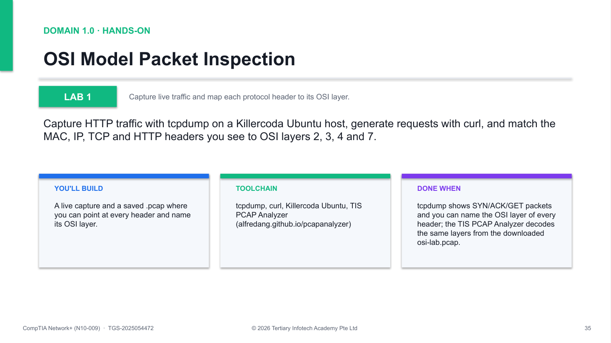

*Figure 1 — how Lab 1 runs: the workflow you will follow.*

**Step-by-step**

1. Install the capture tools

   ```bash
   apt update && apt install -y tcpdump curl
   ```

2. Identify the active interface (the one UP with a routable IP)

   ```bash
   ip -brief addr
   ```

3. Start a background capture of five HTTP packets

   ```bash
   tcpdump -i eth0 -nn -v -c 5 'tcp port 80' &
   ```

4. Generate HTTP traffic to fill the capture

   ```bash
   curl -s http://example.com > /dev/null
   ```

5. Map each header: MAC = L2, IP = L3, TCP ports/flags = L4, HTTP GET = L7
6. Re-run with -e -A to expose L2 MACs and the L7 ASCII payload

   ```bash
   tcpdump -i eth0 -nn -e -A -c 10 'tcp port 80' &
   ```

7. Save a capture, then inspect it layer-by-layer in the TIS PCAP Analyzer

   ```bash
   tcpdump -i eth0 -w osi-lab.pcap -c 20 'tcp port 80' &
   ```

8. Stop any background captures

   ```bash
   kill %1 2>/dev/null
   ```


**Test it**

tcpdump shows SYN/ACK/GET packets and you can name the OSI layer of every header; the TIS PCAP Analyzer decodes the same layers from the downloaded osi-lab.pcap.

**If it doesn't work**

- No packets captured — Check the interface with ip -brief addr — capture on the interface marked UP, not lo.
- curl hangs or fails — The playground may block port 80 — try curl -s http://neverssl.com instead.
- tcpdump: command not found — Re-run apt update && apt install -y tcpdump curl — the install step may have failed.

> **Note:** The full lab file with all commands is in labs/lab-01-osi-packet-inspection/ in the course repository.

---


### Lab 2 — IPv4 Subnetting and CIDR

Exam objective: Split a /24 into four /26 subnets and verify the math with the TIS IP Calculator.

Goal: Use the TIS IP Calculator to break 192.168.10.0/24 into four /26 subnets, record each network, host range and broadcast, then assign an address from subnet 2 to a Linux interface.

**What you'll build**

A completed four-subnet plan and a Linux interface carrying 192.168.10.65/26 as a labelled secondary address.   (Tools: TIS IP Calculator (alfredang.github.io/ipcalculator), iproute2, Killercoda Ubuntu.)

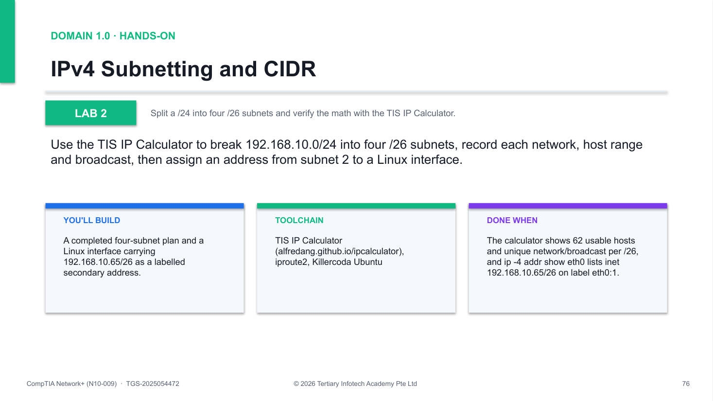

*Figure 2 — how Lab 2 runs: the workflow you will follow.*

**Step-by-step**

1. Open the TIS IP Calculator in a browser tab

   ```bash
   https://alfredang.github.io/ipcalculator/
   ```

2. Enter 192.168.10.0/24 — read network, broadcast, host range and mask
3. Calculate each /26 block: .0, .64, .128 and .192

   ```bash
   192.168.10.0/26 192.168.10.64/26 192.168.10.128/26 192.168.10.192/26
   ```

4. Fill the subnet table: network, first/last host, broadcast for all four
5. Assign an address from subnet 2 to your interface

   ```bash
   ip addr add 192.168.10.65/26 dev eth0 label eth0:1
   ```

6. Verify the secondary address is present

   ```bash
   ip -4 addr show eth0
   ```

7. Clean up the address

   ```bash
   ip addr del 192.168.10.65/26 dev eth0
   ```


**Test it**

The calculator shows 62 usable hosts and unique network/broadcast per /26, and ip -4 addr show eth0 lists inet 192.168.10.65/26 on label eth0:1.

**If it doesn't work**

- Calculator ranges look wrong — Confirm you entered prefix /26, not /24 — the prefix length drives every boundary.
- RTNETLINK: File exists — The address is already assigned — remove it first with ip addr del 192.168.10.65/26 dev eth0.
- Address missing after add — Run as root and check you used dev eth0 — Killercoda's primary NIC is eth0.

> **Note:** The full lab file with all commands is in labs/lab-02-ipv4-subnetting/ in the course repository.

---


### Lab 3 — IPv6 Addressing and Link-Local

Exam objective: Plan an IPv6 /64, add a global address, and ping link-local using a zone ID.

Goal: Break down 2001:db8::/64 in the TIS IP Calculator's IPv6 mode, add a documentation-range global address to eth0, observe the auto-generated fe80:: link-local address, and ping across both.

**What you'll build**

An interface holding both a link-local fe80:: address and a global 2001:db8::10/64, verified by ping.   (Tools: TIS IP Calculator (alfredang.github.io/ipcalculator), iproute2, ping6, Killercoda.)

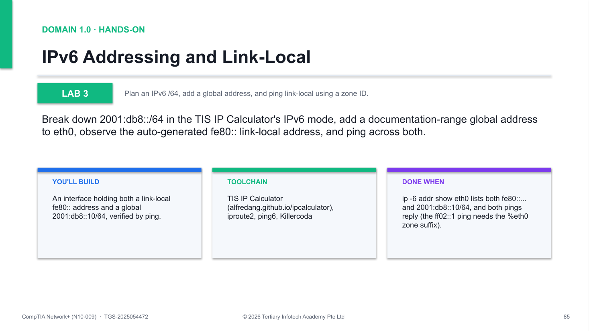

*Figure 3 — how Lab 3 runs: the workflow you will follow.*

**Step-by-step**

1. Open the IP Calculator in IPv6 mode and enter 2001:db8::/64

   ```bash
   https://alfredang.github.io/ipcalculator/
   ```

2. Read prefix, first/last host and total (2^64); split a /48 into /64s
3. Inspect the existing IPv6 config — find the fe80:: link-local

   ```bash
   ip -6 addr show eth0
   ```

4. Add a documentation-range global address

   ```bash
   ip -6 addr add 2001:db8::10/64 dev eth0
   ```

5. Verify both addresses are present

   ```bash
   ip -6 addr show eth0
   ```

6. Ping the all-nodes multicast with a zone ID

   ```bash
   ping6 -c2 ff02::1%eth0
   ```

7. Ping the global address

   ```bash
   ping6 -c2 2001:db8::10
   ```

8. Clean up

   ```bash
   ip -6 addr del 2001:db8::10/64 dev eth0
   ```


**Test it**

ip -6 addr show eth0 lists both fe80::... and 2001:db8::10/64, and both pings reply (the ff02::1 ping needs the %eth0 zone suffix).

**If it doesn't work**

- ping6: Invalid argument — Link-local targets need a zone — use ff02::1%eth0 so the kernel knows the egress interface.
- No fe80:: address on eth0 — IPv6 is disabled — sysctl -w net.ipv6.conf.eth0.disable_ipv6=0, then re-check.
- Global ping fails — Confirm the add worked: ip -6 addr show eth0 must list 2001:db8::10/64 before you ping.

> **Note:** The full lab file with all commands is in labs/lab-03-ipv6-slaac/ in the course repository.

---


### Lab 4 — Common Ports and Protocols

Exam objective: Connect protocol names to well-known port numbers using ss and nmap.

Goal: Enumerate the listening TCP/UDP sockets on your own host with ss, scan the well-known port range of scanme.nmap.org with nmap, and map every open port you find to the N10-009 protocol list.

**What you'll build**

A completed port-to-protocol map covering your own listeners and the remote scan results.   (Tools: nmap, ss, net-tools (netstat), getent, Killercoda Ubuntu.)

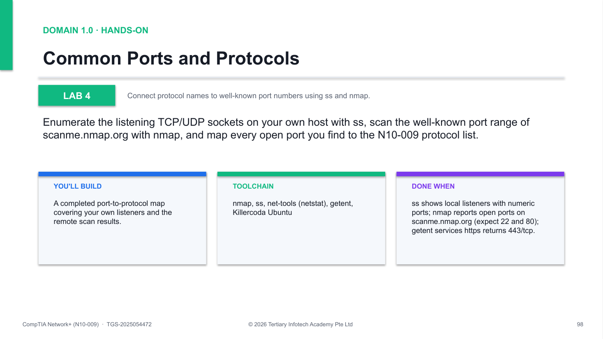

*Figure 4 — how Lab 4 runs: the workflow you will follow.*

**Step-by-step**

1. Install nmap and net-tools

   ```bash
   apt update && apt install -y nmap net-tools
   ```

2. List TCP/UDP listeners on your own host with owning processes

   ```bash
   ss -tulnp
   ```

3. Scan the well-known range on the Nmap project's test host

   ```bash
   nmap -sT -p 1-1024 scanme.nmap.org
   ```

4. Map each open port to the exam list (22 SSH, 53 DNS, 80 HTTP, 443 HTTPS...)
5. Resolve service names to port numbers

   ```bash
   getent services https
   ```


**Test it**

ss shows local listeners with numeric ports; nmap reports open ports on scanme.nmap.org (expect 22 and 80); getent services https returns 443/tcp.

**If it doesn't work**

- nmap scan returns nothing — Check egress with ping scanme.nmap.org — playground networks can be slow; re-run the scan.
- ss: command not found — Use netstat -tulnp from net-tools instead — both list the same listening sockets.
- Ports show names, not numbers — Keep the -n flag (ss -tulnp) so output stays numeric and you learn the numbers.

> **Note:** The full lab file with all commands is in labs/lab-04-common-ports/ in the course repository.

---


### Lab 5 — DNS Record Types

Exam objective: Query every N10-009 DNS record type with dig and interpret the answers.

Goal: Use dig to query A, AAAA, MX, TXT, NS, CNAME, PTR, SOA and SRV records against live domains, reading addresses, mail priorities, aliases and zone-authority data from the answers.

**What you'll build**

A worked set of dig queries — one per record type on the exam — with each answer interpreted.   (Tools: dig, nslookup, host (dnsutils), Killercoda Ubuntu.)

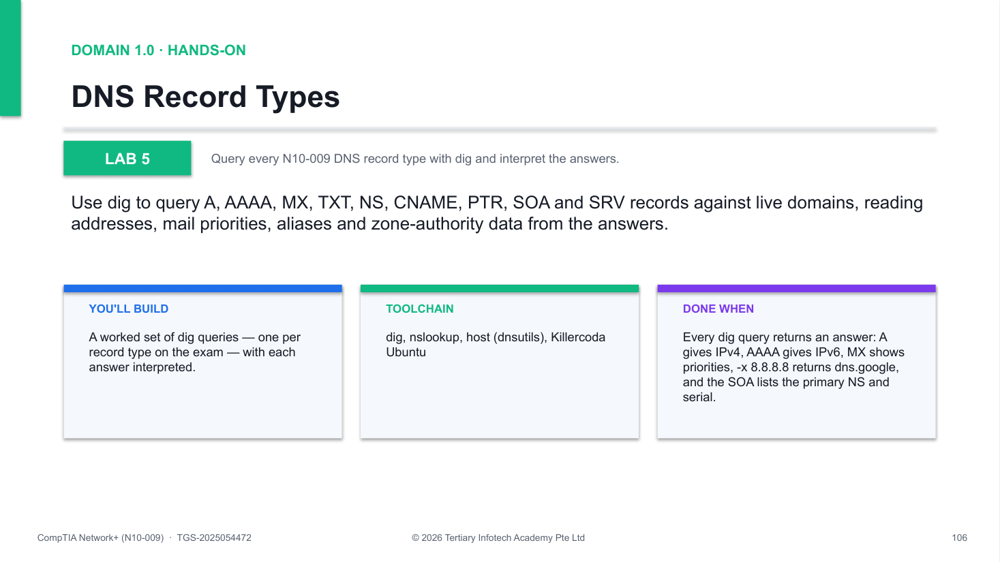

*Figure 5 — how Lab 5 runs: the workflow you will follow.*

**Step-by-step**

1. Install dnsutils (provides dig, nslookup and host)

   ```bash
   apt update && apt install -y dnsutils
   ```

2. Query the A record (name to IPv4)

   ```bash
   dig +short A google.com
   ```

3. Query the AAAA record (name to IPv6)

   ```bash
   dig +short AAAA google.com
   ```

4. Query MX — the leading number is priority, lower wins

   ```bash
   dig +short MX google.com
   ```

5. Query TXT (SPF/DKIM text) and NS (authoritative servers)

   ```bash
   dig +short TXT google.com
   ```

6. Query a CNAME alias — it points to a name, never an IP

   ```bash
   dig +short CNAME www.github.com
   ```

7. Reverse-resolve an IP to a name (PTR)

   ```bash
   dig +short -x 8.8.8.8
   ```

8. Read the zone authority (SOA): serial, refresh timers

   ```bash
   dig +short SOA google.com
   ```

9. Locate a service with an SRV record

   ```bash
   dig +short SRV _xmpp-server._tcp.gmail.com
   ```


**Test it**

Every dig query returns an answer: A gives IPv4, AAAA gives IPv6, MX shows priorities, -x 8.8.8.8 returns dns.google, and the SOA lists the primary NS and serial.

**If it doesn't work**

- dig: command not found — Install the tools: apt update && apt install -y dnsutils.
- Empty answer for CNAME — Not every name has one — query an alias such as www.github.com, not the bare domain.
- SERVFAIL or timeout — Query an explicit resolver: dig @8.8.8.8 +short A google.com to bypass the local stub.

> **Note:** The full lab file with all commands is in labs/lab-05-dns-records/ in the course repository.

---


### Lab 6 — DHCP Lease Capture (DORA)

Exam objective: Capture all four DHCP DORA messages during a live lease renewal.

Goal: Run tcpdump against UDP ports 67/68 while releasing and re-requesting your DHCP lease with dhclient, then identify the Discover, Offer, Request and Acknowledge messages in the capture.

**What you'll build**

A capture showing the full DORA exchange and a freshly renewed lease on eth0.   (Tools: isc-dhcp-client (dhclient), tcpdump, Killercoda Ubuntu.)

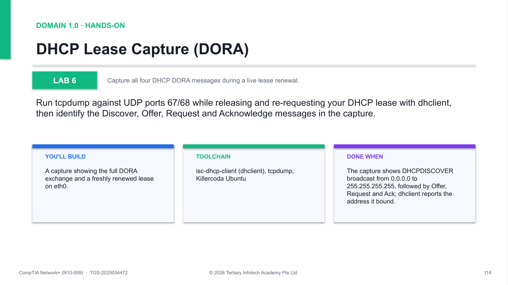

*Figure 6 — how Lab 6 runs: the workflow you will follow.*

**Step-by-step**

1. Install the DHCP client and capture tools

   ```bash
   apt update && apt install -y isc-dhcp-client tcpdump
   ```

2. Start a background capture on the DHCP ports

   ```bash
   tcpdump -i eth0 -nn -v 'port 67 or port 68' &
   ```

3. Release the current lease (sends DHCPRELEASE)

   ```bash
   dhclient -v -r eth0
   ```

4. Request a new lease

   ```bash
   dhclient -v eth0
   ```

5. Identify Discover, Offer, Request and Ack in the tcpdump output
6. Stop the capture

   ```bash
   kill %1 2>/dev/null
   ```


**Test it**

The capture shows DHCPDISCOVER broadcast from 0.0.0.0 to 255.255.255.255, followed by Offer, Request and Ack; dhclient reports the address it bound.

**If it doesn't work**

- Connectivity lost after release — Expected — dhclient -v eth0 re-acquires a lease; if the session breaks, reload the playground.
- No DHCP packets in capture — Check the filter is 'port 67 or port 68' and start the capture before releasing.
- dhclient: command not found — Install it: apt update && apt install -y isc-dhcp-client.

> **Note:** The full lab file with all commands is in labs/lab-06-dhcp-capture/ in the course repository.

---


### Lab 7 — Simulating a Cloud VPC with Namespaces

Exam objective: Build a VPC-style virtual network from namespaces, a bridge and veth pairs.

Goal: Recreate cloud VPC building blocks on one Linux host: two network namespaces act as VMs, a Linux bridge acts as the virtual switch, and veth pairs cable them together on subnet 10.0.1.0/24.

**What you'll build**

Two isolated 'VMs' (web and db) pinging each other through a Linux bridge — a working VPC subnet.   (Tools: iproute2 (ip netns, ip link, veth, bridge), Killercoda Ubuntu.)

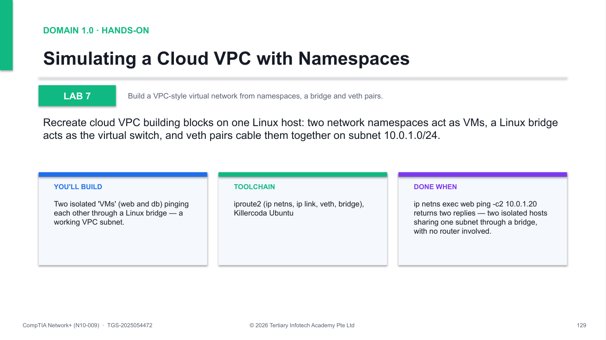

*Figure 7 — how Lab 7 runs: the workflow you will follow.*

**Step-by-step**

1. Create two namespaces to act as the VMs

   ```bash
   ip netns add web && ip netns add db
   ```

2. Create the bridge — the VPC's virtual switch

   ```bash
   ip link add br0 type bridge && ip link set br0 up
   ```

3. Create a veth 'virtual cable' for each namespace

   ```bash
   ip link add veth-web type veth peer name br-web
   ```

4. Attach the bridge-side ends and bring them up

   ```bash
   ip link set br-web master br0 && ip link set br-web up
   ```

5. Move the VM-side ends into their namespaces

   ```bash
   ip link set veth-web netns web
   ```

6. Assign IPs in the same /24 and bring links (and lo) up

   ```bash
   ip netns exec web ip addr add 10.0.1.10/24 dev veth-web
   ```

7. Test connectivity between the two 'VMs'

   ```bash
   ip netns exec web ping -c2 10.0.1.20
   ```

8. Clean up

   ```bash
   ip netns del web && ip netns del db && ip link del br0
   ```


**Test it**

ip netns exec web ping -c2 10.0.1.20 returns two replies — two isolated hosts sharing one subnet through a bridge, with no router involved.

**If it doesn't work**

- Network is unreachable — Bring interfaces up in both namespaces, including lo, and re-check the 10.0.1.x addresses.
- Destination Host Unreachable — Verify both bridge-side ends are enslaved and up: ip link set br-web master br0 (and br-db).
- Cannot find device veth-web — That end now lives inside the namespace — manage it via ip netns exec web ip link ...

> **Note:** The full lab file with all commands is in labs/lab-07-cloud-vpc-namespaces/ in the course repository.

---


## Domain 2.0 — Network Implementation  (20%)

Routing technologies · switching technologies · wireless devices · physical installations

**Key concepts**

- Routing technologies — Static vs dynamic routing — BGP, EIGRP, OSPF — route selection, NAT/PAT, FHRP, VIP and subinterfaces.
- Switching technologies — VLANs and SVIs, interface configuration, 802.1Q trunking, spanning tree, MTU and jumbo frames.
- Wireless devices — Channels and channel width, 2.4/5/6 GHz bands, SSIDs, encryption, guest networks, authentication, antennas and AP placement.
- Physical installations — Installation implications, power (UPS, PDU) considerations and environmental factors (HVAC, fire suppression).


### Lab 8 — Static Routing Between Two Subnets

Exam objective: Build a two-subnet topology and route between them with static routes.

Goal: Create three network namespaces (host A, router R1, host B), wire them with veth pairs, enable IP forwarding on R1 and add the static routes that let 10.1.1.0/24 reach 10.2.2.0/24.

**What you'll build**

A working routed path A -> R1 -> B with hand-written static routes on both end hosts.   (Tools: iproute2, ip netns, sysctl.)

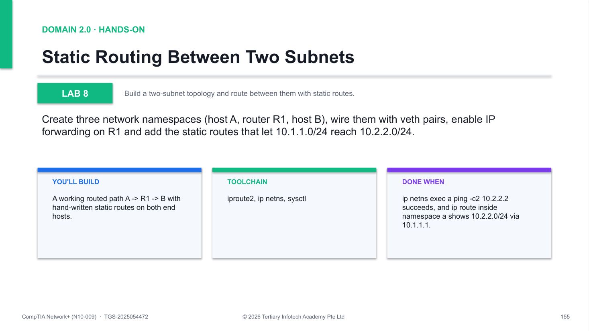

*Figure 8 — how Lab 8 runs: the workflow you will follow.*

**Step-by-step**

1. Create three namespaces; r1 is the router

   ```bash
   ip netns add a && ip netns add r1 && ip netns add b
   ```

2. Wire A-R1 and B-R1 with veth pairs

   ```bash
   ip link add a-r type veth peer name r-a
   ```

3. Move each veth end into its namespace

   ```bash
   ip link set a-r netns a && ip link set r-a netns r1
   ```

4. Assign IPs from two different subnets

   ```bash
   ip netns exec a ip addr add 10.1.1.2/24 dev a-r
   ```

5. Bring up loopbacks and all veth interfaces

   ```bash
   for n in a r1 b; do ip netns exec $n ip link set lo up; done
   ```

6. Enable IP forwarding on the router

   ```bash
   ip netns exec r1 sysctl -w net.ipv4.ip_forward=1
   ```

7. Add static routes on each end host via R1

   ```bash
   ip netns exec a ip route add 10.2.2.0/24 via 10.1.1.1
   ```

8. Verify with ping, inspect the table, clean up

   ```bash
   ip netns exec a ping -c2 10.2.2.2
   ```


**Test it**

ip netns exec a ping -c2 10.2.2.2 succeeds, and ip route inside namespace a shows 10.2.2.0/24 via 10.1.1.1.

**If it doesn't work**

- Ping A to B fails — Check forwarding: ip netns exec r1 sysctl net.ipv4.ip_forward must return 1
- Network is unreachable — A static route is missing — re-add: ip route add 10.2.2.0/24 via 10.1.1.1
- Interface shows DOWN — Bring up BOTH ends of each veth pair with ip link set <if> up

> **Note:** The full lab file with all commands is in labs/lab-08-static-routing/ in the course repository.

---


### Lab 9 — 802.1Q VLAN Tagging

Exam objective: Create 802.1Q VLAN sub-interfaces and capture a tagged frame.

Goal: Load the 8021q kernel module, create eth0.10 and eth0.20 sub-interfaces each with its own subnet, verify the VLAN IDs with ip -d link, then capture a live tagged frame with tcpdump -e.

**What you'll build**

Two VLAN sub-interfaces on one NIC — a Linux model of a trunk port — plus a captured 802.1Q tag.   (Tools: iproute2, 8021q module, tcpdump.)

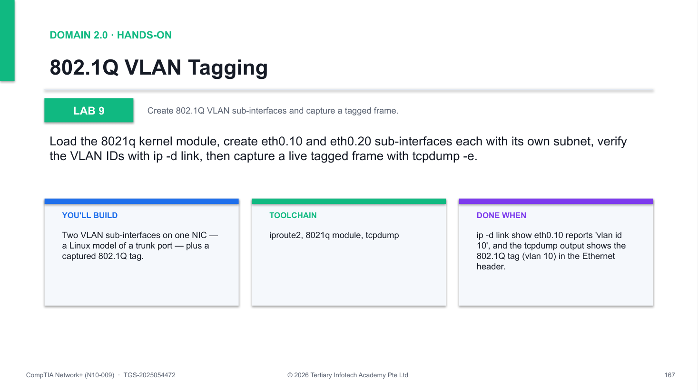

*Figure 9 — how Lab 9 runs: the workflow you will follow.*

**Step-by-step**

1. Load the 802.1Q kernel module

   ```bash
   modprobe 8021q && lsmod | grep 8021q
   ```

2. Create the VLAN 10 sub-interface on eth0

   ```bash
   ip link add link eth0 name eth0.10 type vlan id 10
   ```

3. Create the VLAN 20 sub-interface

   ```bash
   ip link add link eth0 name eth0.20 type vlan id 20
   ```

4. Assign each VLAN its own subnet and bring up

   ```bash
   ip addr add 192.168.10.1/24 dev eth0.10
   ```

5. Verify the VLAN ID with detailed link show

   ```bash
   ip -d link show eth0.10
   ```

6. Start a capture that prints Ethernet headers

   ```bash
   tcpdump -i eth0 -nn -e vlan &
   ```

7. Ping through the VLAN interface, stop capture

   ```bash
   ping -c2 -I eth0.10 192.168.10.1
   ```

8. Clean up

   ```bash
   ip link del eth0.10 && ip link del eth0.20
   ```


**Test it**

ip -d link show eth0.10 reports 'vlan id 10', and the tcpdump output shows the 802.1Q tag (vlan 10) in the Ethernet header.

**If it doesn't work**

- modprobe: module not found — apt update first; the 8021q module ships with standard Ubuntu kernels
- No vlan tag in tcpdump output — Capture on the parent eth0 with -e; tags are already stripped on the sub-interface
- RTNETLINK: File exists — The sub-interface already exists — ip link del eth0.10, then recreate it

> **Note:** The full lab file with all commands is in labs/lab-09-vlan-tagging/ in the course repository.

---


### Lab 10 — Link Aggregation (LACP Bond)

Exam objective: Bundle interfaces into an LACP (802.3ad) bond and inspect its state.

Goal: Install ifenslave, load the bonding driver in 802.3ad mode, create bond0, enslave a NIC and read the LACP aggregator, partner MAC and per-slave link state from /proc/net/bonding/bond0.

**What you'll build**

A bond0 interface running LACP with aggregator and slave state visible in /proc/net/bonding/bond0.   (Tools: ifenslave, bonding module, iproute2.)

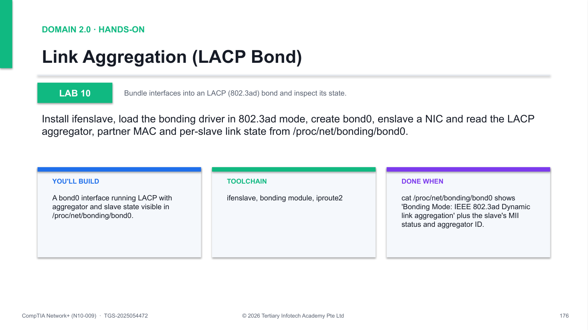

*Figure 10 — how Lab 10 runs: the workflow you will follow.*

**Step-by-step**

1. Install ifenslave

   ```bash
   apt update && apt install -y ifenslave
   ```

2. Load the bonding driver in LACP mode

   ```bash
   modprobe bonding mode=802.3ad miimon=100
   ```

3. Create the bond interface

   ```bash
   ip link add bond0 type bond mode 802.3ad
   ```

4. Enslave the NIC (on real hardware, add two)

   ```bash
   ip link set eth0 down && ip link set eth0 master bond0
   ```

5. Bring up the slave and the bond

   ```bash
   ip link set eth0 up && ip link set bond0 up
   ```

6. Inspect LACP partner, aggregator, slave state

   ```bash
   cat /proc/net/bonding/bond0
   ```

7. Clean up

   ```bash
   ip link set eth0 nomaster && ip link del bond0
   ```


**Test it**

cat /proc/net/bonding/bond0 shows 'Bonding Mode: IEEE 802.3ad Dynamic link aggregation' plus the slave's MII status and aggregator ID.

**If it doesn't work**

- Playground disconnects — Enslaving the only NIC drops Killercoda — rebuild the playground or use a multi-NIC VM
- bond0 shows no partner MAC — The peer must speak LACP too; without an 802.3ad partner the aggregator stays down
- Cannot enslave eth0 — Set the interface down first (ip link set eth0 down), then set master bond0

> **Note:** The full lab file with all commands is in labs/lab-10-link-aggregation/ in the course repository.

---


### Lab 11 — Wireless Concepts and Channel Survey

Exam objective: Survey nearby wireless networks and map channels, bands and security modes.

Goal: Use iw on a wireless laptop (or WiFi Analyzer / Wireless Diagnostics) to scan nearby APs, recording each SSID's channel, signal and security mode, then map channels to bands and compare WEP through WPA3.

**What you'll build**

A site-survey table of nearby APs: SSID, band, channel, signal (dBm) and security mode.   (Tools: iw, wavemon, WiFi Analyzer (Windows), Wireless Diagnostics (macOS).)

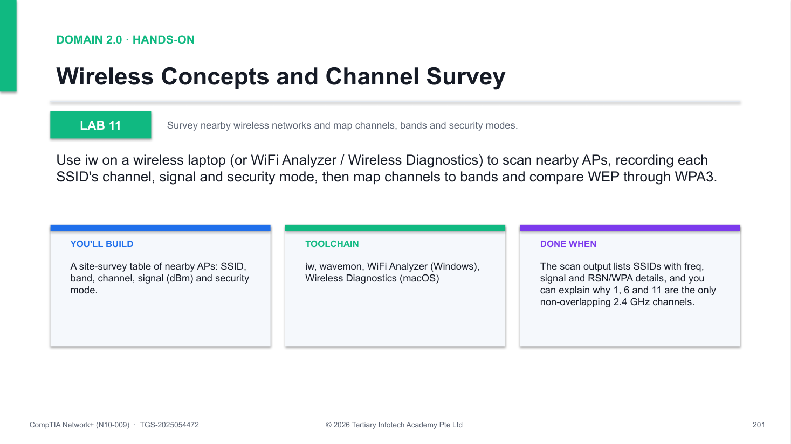

*Figure 11 — how Lab 11 runs: the workflow you will follow.*

**Step-by-step**

1. On a wireless laptop, list supported PHYs/bands

   ```bash
   iw list | less
   ```

2. Scan nearby APs for SSID, channel, signal, security

   ```bash
   iw dev wlan0 scan | grep -E "SSID|freq|signal|RSN|WPA"
   ```

3. Record each AP: SSID, channel, dBm, WPA2/WPA3 mode
4. Map channels to bands: 2.4 GHz 1/6/11; 5 GHz 36-165 (DFS); 6 GHz PSC
5. Compare security modes from WEP to WPA3-SAE and WPA3-Enterprise
6. Quiz: why only 1/6/11 overlap-free; what DFS does; why 6E needs WPA3

**Test it**

The scan output lists SSIDs with freq, signal and RSN/WPA details, and you can explain why 1, 6 and 11 are the only non-overlapping 2.4 GHz channels.

**If it doesn't work**

- iw: command not found — apt install iw wavemon on Linux; on Windows/macOS use the free analyzer apps instead
- Scan returns nothing — Run as root, check the interface name with iw dev, and rfkill unblock wifi
- No 6 GHz networks visible — The adapter must support Wi-Fi 6E; older NICs only report 2.4/5 GHz BSSs

> **Note:** The full lab file with all commands is in labs/lab-11-wireless-concepts/ in the course repository.

---


### Lab 12 — NAT and PAT with iptables

Exam objective: Configure PAT with iptables MASQUERADE and verify live translations in conntrack.

Goal: Rebuild a namespace client behind the host, enable forwarding, add a MASQUERADE rule on eth0, prove the source address is rewritten with curl ifconfig.me, and inspect the live translation table with conntrack -L.

**What you'll build**

A namespace reaching the Internet through the host's IP — many-to-one PAT exactly as a SOHO router does it.   (Tools: iptables, conntrack, iproute2, curl.)

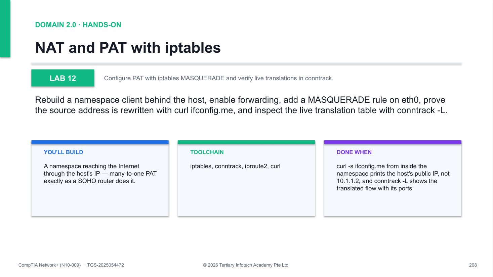

*Figure 12 — how Lab 12 runs: the workflow you will follow.*

**Step-by-step**

1. Create namespace a wired to the host via veth

   ```bash
   ip netns add a && ip link add a-h type veth peer name h-a
   ```

2. Address both ends; default route via the host

   ```bash
   ip netns exec a ip route add default via 10.1.1.1
   ```

3. Enable IP forwarding on the host

   ```bash
   sysctl -w net.ipv4.ip_forward=1
   ```

4. Add the MASQUERADE (PAT) rule for the subnet

   ```bash
   iptables -t nat -A POSTROUTING -s 10.1.1.0/24 -o eth0 -j MASQUERADE
   ```

5. Test: the public IP proves the translation

   ```bash
   ip netns exec a curl -s ifconfig.me
   ```

6. Inspect live translations in conntrack

   ```bash
   apt install -y conntrack && conntrack -L | head
   ```

7. Clean up

   ```bash
   iptables -t nat -F POSTROUTING && ip netns del a
   ```


**Test it**

curl -s ifconfig.me from inside the namespace prints the host's public IP, not 10.1.1.2, and conntrack -L shows the translated flow with its ports.

**If it doesn't work**

- Ping 8.8.8.8 fails from namespace — Check ip_forward=1 and that the default route inside a points at 10.1.1.1
- curl still shows 10.1.1.2 — MASQUERADE rule missing or wrong -o interface; list with iptables -t nat -L -v
- conntrack: command not found — apt install -y conntrack, then rerun conntrack -L

> **Note:** The full lab file with all commands is in labs/lab-12-nat-pat/ in the course repository.

---


### Lab 13 — DHCP Server with isc-dhcp-server

Exam objective: Configure isc-dhcp-server to lease addresses on a private subnet.

Goal: Install isc-dhcp-server, create a dummy interface at 10.50.0.1/24, write a scope with range, router, DNS and lease-time options, bind the daemon to dum0 only, start it and inspect the leases file.

**What you'll build**

A running authoritative DHCP server scoped to 10.50.0.100-150 on dum0, leaving eth0 untouched.   (Tools: isc-dhcp-server, iproute2, systemd.)

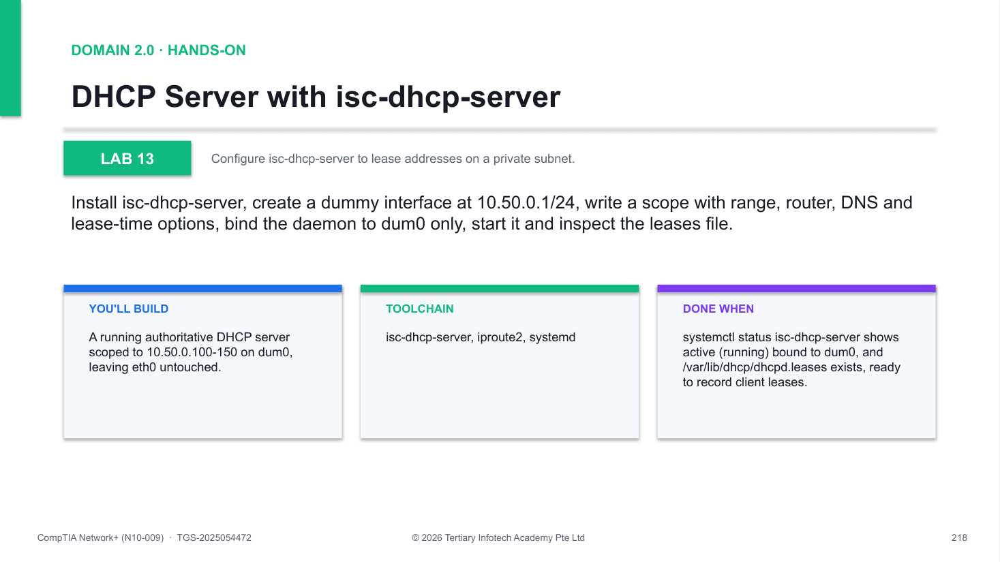

*Figure 13 — how Lab 13 runs: the workflow you will follow.*

**Step-by-step**

1. Install the ISC DHCP server

   ```bash
   apt update && apt install -y isc-dhcp-server
   ```

2. Create a dummy interface so eth0 is untouched

   ```bash
   ip link add dum0 type dummy && ip addr add 10.50.0.1/24 dev dum0
   ```

3. Bring the dummy interface up

   ```bash
   ip link set dum0 up
   ```

4. Write the scope: range, routers, DNS, lease times

   ```bash
   cat >/etc/dhcp/dhcpd.conf <<EOF
   ```

5. Bind the daemon to dum0 only

   ```bash
   sed -i 's/^INTERFACESv4=.*/INTERFACESv4="dum0"/' /etc/default/isc-dhcp-server
   ```

6. Restart and check the service

   ```bash
   systemctl restart isc-dhcp-server
   ```

7. Inspect the leases file

   ```bash
   cat /var/lib/dhcp/dhcpd.leases
   ```

8. Clean up

   ```bash
   systemctl stop isc-dhcp-server && ip link del dum0
   ```


**Test it**

systemctl status isc-dhcp-server shows active (running) bound to dum0, and /var/lib/dhcp/dhcpd.leases exists, ready to record client leases.

**If it doesn't work**

- Service fails to start — Syntax-check with dhcpd -t; every option line in dhcpd.conf must end with a semicolon
- Daemon not listening on dum0 — Confirm INTERFACESv4="dum0" in /etc/default/isc-dhcp-server, then restart
- Leases file is empty — Normal until a client DISCOVERs on 10.50.0.0/24; leases are appended as granted

> **Note:** The full lab file with all commands is in labs/lab-13-dhcp-server/ in the course repository.

---


### Lab 14 — Authoritative DNS with BIND9

Exam objective: Host an authoritative DNS zone in BIND9 and query it with dig.

Goal: Install bind9, write a zone file for lab.local with SOA, NS, A and MX records, register the zone in named.conf.local, validate the syntax with named-checkzone and query your own server with dig @127.0.0.1.

**What you'll build**

A local BIND9 server answering authoritatively for lab.local, with validated zone syntax.   (Tools: bind9, dnsutils (dig), named-checkzone.)

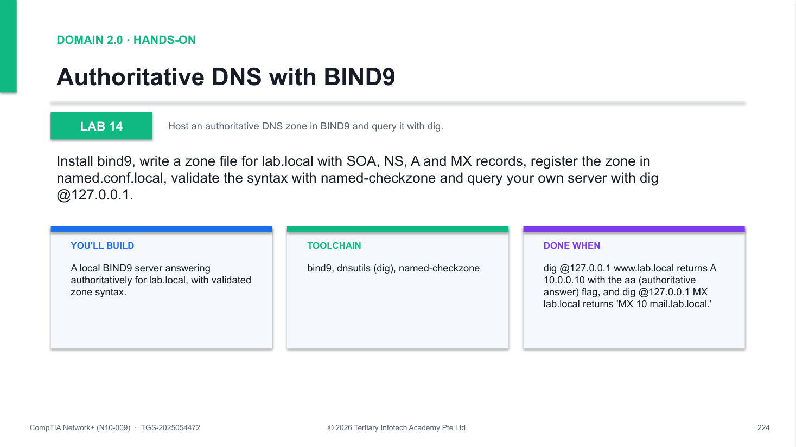

*Figure 14 — how Lab 14 runs: the workflow you will follow.*

**Step-by-step**

1. Install BIND9 and dig

   ```bash
   apt update && apt install -y bind9 dnsutils
   ```

2. Create /etc/bind/db.lab.local with SOA, NS, A, MX

   ```bash
   cat >/etc/bind/db.lab.local <<'EOF'
   ```

3. Register zone lab.local as type master

   ```bash
   cat >>/etc/bind/named.conf.local <<'EOF'
   ```

4. Validate the zone syntax before reloading

   ```bash
   named-checkzone lab.local /etc/bind/db.lab.local
   ```

5. Restart BIND

   ```bash
   systemctl restart bind9
   ```

6. Query your own server for A and MX records

   ```bash
   dig @127.0.0.1 www.lab.local
   ```

7. Clean up

   ```bash
   systemctl stop bind9
   ```


**Test it**

dig @127.0.0.1 www.lab.local returns A 10.0.0.10 with the aa (authoritative answer) flag, and dig @127.0.0.1 MX lab.local returns 'MX 10 mail.lab.local.'

**If it doesn't work**

- named-checkzone reports errors — Check the SOA parentheses and the trailing dots on FQDNs like ns.lab.local.
- dig times out — BIND is not running — systemctl status bind9; verify config with named-checkconf
- SERVFAIL for lab.local — The zone failed to load; journalctl -u named shows the parse error — fix, restart

> **Note:** The full lab file with all commands is in labs/lab-14-bind9-dns/ in the course repository.

---


## Domain 3.0 — Network Operations  (19%)

Documentation · life-cycle · change & configuration management · monitoring · DR · network services · access & management

**Key concepts**

- Documentation — Physical vs logical diagrams, rack diagrams, cable maps, asset inventory, IPAM, SLA and wireless surveys.
- Life-cycle & change — EOL/EOS, software management, decommissioning and the change-request process.
- Configuration management — Production, backup and baseline configurations.
- Network monitoring — SNMP, flow data, packet capture, baseline metrics, log aggregation, API integration and port mirroring.
- Disaster recovery — RPO, RTO, MTTR, MTBF; cold/warm/hot sites; active-active vs active-passive; DR testing.
- Network services — DHCP, SLAAC, DNS, NTP, PTP and NTS.
- Access & management — Site-to-site and client VPNs, SSH, GUI, API and console access.


### Lab 15 — SNMP Monitoring

Exam objective: Configure an SNMP agent and poll MIB objects with snmpwalk and snmpget (OBJ 3.2).

Goal: Install snmpd on Ubuntu, configure a read-only v2c community string, then walk the system and IF-MIB subtrees to read uptime, interface names and live traffic counters — the raw data every NMS graphs.

**What you'll build**

A polling-ready SNMP agent on UDP/161 answering v2c queries, plus walked system and interface OIDs.   (Tools: snmpd, snmpwalk, snmpget, snmp-mibs-downloader.)


*Figure 15 — how Lab 15 runs: the workflow you will follow.*

**Step-by-step**

1. Install the SNMP agent and client tools

   ```bash
   apt update && apt install -y snmpd snmp snmp-mibs-downloader
   ```

2. Add a read-only community for loopback queries

   ```bash
   echo 'rocommunity public 127.0.0.1' >> /etc/snmp/snmpd.conf
   ```

3. Restart the agent to load the new configuration

   ```bash
   systemctl restart snmpd
   ```

4. Walk the system subtree — sysDescr, sysName, sysUpTime

   ```bash
   snmpwalk -v2c -c public 127.0.0.1 system
   ```

5. Fetch a single OID with snmpget

   ```bash
   snmpget -v2c -c public 127.0.0.1 sysUpTime.0
   ```

6. Walk the per-interface traffic counters in IF-MIB

   ```bash
   snmpwalk -v2c -c public 127.0.0.1 IF-MIB::ifInOctets
   ```


**Test it**

snmpwalk returns sysDescr/sysUpTime values and IF-MIB::ifInOctets shows a rising octet counter per interface — rerun it and watch the numbers grow.

**If it doesn't work**

- Timeout: No Response from 127.0.0.1 — Restart snmpd and confirm agentaddress in snmpd.conf includes udp:127.0.0.1:161.
- Output shows numeric OIDs only — Install snmp-mibs-downloader and comment out the 'mibs :' line in /etc/snmp/snmp.conf.
- Authentication/community failure — Community mismatch — use -c public and confirm the rocommunity line was appended to snmpd.conf.

> **Note:** The full lab file with all commands is in labs/lab-15-snmp-monitoring/ in the course repository.

---


### Lab 16 — NetFlow Analysis with nfdump

Exam objective: Export, collect and analyse flow data to find top talkers and busiest ports (OBJ 3.2).

Goal: Run a flow exporter (fprobe) and collector (nfcapd) on one VM, generate web and ICMP traffic, then use nfdump to build top-talker and destination-port reports from the captured flow records.

**What you'll build**

A working exporter-to-collector NetFlow v5 pipeline with nfdump top-N reports of your own traffic.   (Tools: fprobe, nfcapd, nfdump, curl, ping.)


*Figure 16 — how Lab 16 runs: the workflow you will follow.*

**Step-by-step**

1. Install the flow collector and exporter

   ```bash
   apt update && apt install -y nfdump fprobe
   ```

2. Start the nfcapd collector daemon on UDP/9995

   ```bash
   mkdir -p /tmp/flows && nfcapd -p 9995 -l /tmp/flows -D
   ```

3. Start fprobe exporting NetFlow v5 records from eth0

   ```bash
   fprobe -i eth0 127.0.0.1:9995
   ```

4. Generate web and ICMP traffic to create flows

   ```bash
   curl -s https://example.com > /dev/null && ping -c5 8.8.8.8
   ```

5. Wait for the collector to roll a file, then list flows

   ```bash
   sleep 60 && nfdump -R /tmp/flows -o long | head
   ```

6. Summarise top talker IPs and busiest destination ports

   ```bash
   nfdump -R /tmp/flows -s srcip
   ```

7. Stop the exporter and collector

   ```bash
   pkill fprobe && pkill nfcapd
   ```


**Test it**

nfdump -R /tmp/flows -s srcip lists your VM as a top talker and -s dstport shows ports 443 and ICMP traffic from the curl and ping you generated.

**If it doesn't work**

- nfdump: no matched flows — Wait the full 60 s — nfcapd only rolls a readable file every rotation interval.
- Collector directory is empty — Confirm fprobe points at 127.0.0.1:9995 and nfcapd is running with -p 9995 (check with ps).
- fprobe: no such device eth0 — List interfaces with ip link and start fprobe against the VM's actual NIC name.

> **Note:** The full lab file with all commands is in labs/lab-16-netflow/ in the course repository.

---


### Lab 17 — Centralised Logging with Rsyslog

Exam objective: Build a syslog forwarding pipeline and filter aggregated events by severity and pattern (OBJ 3.2).

Goal: Configure rsyslog to receive on TCP/514 and forward to itself over loopback, inject test events with logger, then verify and filter the aggregated log — including a regex built in the TIS Regex Generator.

**What you'll build**

A send-and-receive rsyslog collector on TCP/514 with verified test events and regex-filtered output.   (Tools: rsyslog, logger, ss, grep -E, TIS Regex Generator.)

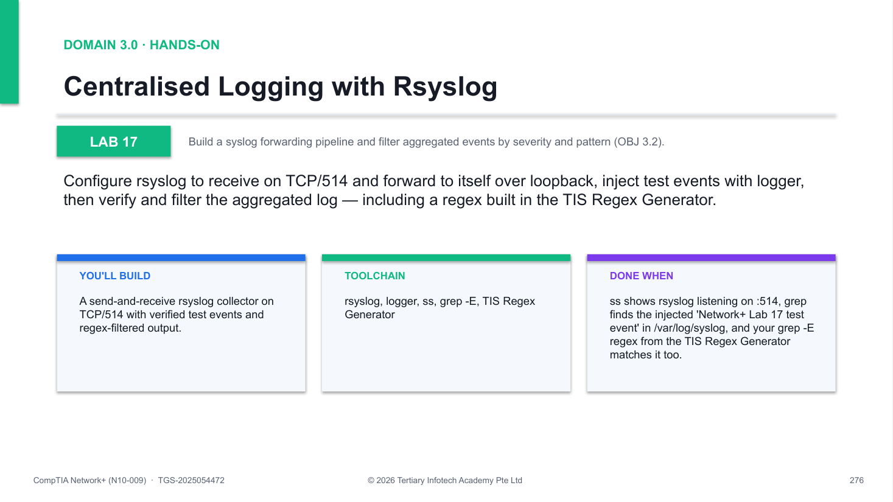

*Figure 17 — how Lab 17 runs: the workflow you will follow.*

**Step-by-step**

1. Enable the imtcp receiver module in rsyslog.conf

   ```bash
   sed -i 's/#module(load="imtcp")/module(load="imtcp")/' /etc/rsyslog.conf
   ```

2. Open the TCP/514 listener input

   ```bash
   sed -i 's/#input(type="imtcp" port="514")/input(type="imtcp" port="514")/' /etc/rsyslog.conf
   ```

3. Forward every event to the collector over TCP (@@ = TCP)

   ```bash
   echo '*.* @@127.0.0.1:514' > /etc/rsyslog.d/50-forward.conf
   ```

4. Restart rsyslog and confirm the 514 listener

   ```bash
   systemctl restart rsyslog && ss -tlnp | grep 514
   ```

5. Inject a test event with an explicit facility.severity

   ```bash
   logger -p local0.info "Network+ Lab 17 test event"
   ```

6. Verify the event landed in the aggregated log

   ```bash
   grep "Lab 17 test" /var/log/syslog
   ```

7. Build a regex in the TIS Regex Generator and filter with grep -E

   ```bash
   grep -E 'Lab 1[0-9] test' /var/log/syslog
   ```


**Test it**

ss shows rsyslog listening on :514, grep finds the injected 'Network+ Lab 17 test event' in /var/log/syslog, and your grep -E regex from the TIS Regex Generator matches it too.

**If it doesn't work**

- Nothing listening on port 514 — Both sed edits must apply — recheck rsyslog.conf uncommented imtcp lines, then restart rsyslog.
- Test event missing from syslog — Run logger without -p first; then check /etc/rsyslog.d/50-forward.conf uses @@127.0.0.1:514.
- grep -E returns no matches — Test the regex in the TIS Regex Generator against a pasted log line before using it with grep.

> **Note:** The full lab file with all commands is in labs/lab-17-syslog/ in the course repository.

---


### Lab 18 — Time Synchronisation with Chrony

Exam objective: Configure NTP time sync with chrony and interpret stratum, offset and drift (OBJ 3.4).

Goal: Install chrony (the modern ntpd replacement), inspect the selected time sources and stratum hierarchy, add an extra NTP server with iburst, and force an immediate clock step.

**What you'll build**

A VM synchronised over UDP/123 with multiple NTP sources and a readable chronyc tracking report.   (Tools: chrony, chronyc.)

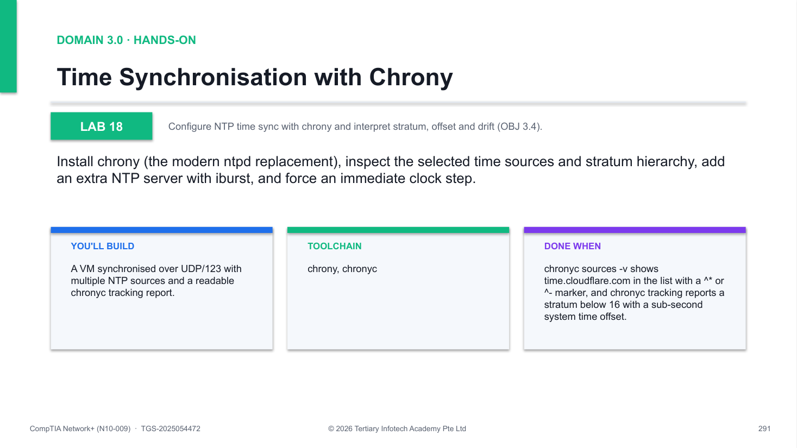

*Figure 18 — how Lab 18 runs: the workflow you will follow.*

**Step-by-step**

1. Install chrony and start the service

   ```bash
   apt update && apt install -y chrony && systemctl enable --now chrony
   ```

2. List time sources — ^* marks the selected server

   ```bash
   chronyc sources -v
   ```

3. Show stratum, current offset and recent drift

   ```bash
   chronyc tracking
   ```

4. Add an extra NTP server with iburst for fast selection

   ```bash
   echo "server time.cloudflare.com iburst" >> /etc/chrony/chrony.conf
   ```

5. Restart chrony and re-check the source list

   ```bash
   systemctl restart chrony && chronyc sources -v
   ```

6. Force an immediate clock step

   ```bash
   chronyc -a makestep
   ```


**Test it**

chronyc sources -v shows time.cloudflare.com in the list with a ^* or ^- marker, and chronyc tracking reports a stratum below 16 with a sub-second system time offset.

**If it doesn't work**

- All sources show ^? unreachable — UDP/123 egress may be blocked — wait for retries, or verify with chronyc activity and tracking.
- New server never appears — The server line must be in /etc/chrony/chrony.conf and chrony restarted — check for typos.
- Stratum shows 16 — 16 means unsynchronised — run chronyc -a makestep and give the sources a minute to be selected.

> **Note:** The full lab file with all commands is in labs/lab-18-ntp/ in the course repository.

---


### Lab 19 — Configuration Backup with Git

Exam objective: Put network configuration under version control for history, diff, blame and rollback (OBJ 3.1).

Goal: Initialise a git repository in /etc, commit a baseline of the critical network configs, make and commit a change, inspect the audit trail with log and show, then roll the change back with revert.

**What you'll build**

A version-controlled /etc with a baseline commit, a tracked change, and a demonstrated one-command rollback.   (Tools: git.)

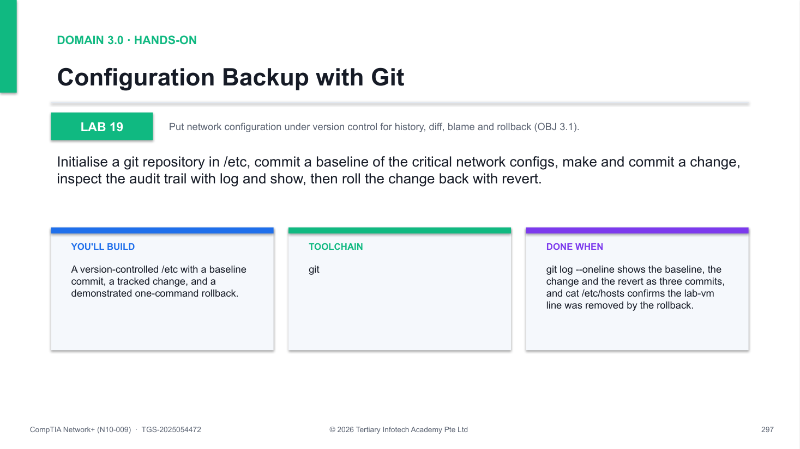

*Figure 19 — how Lab 19 runs: the workflow you will follow.*

**Step-by-step**

1. Install git

   ```bash
   apt update && apt install -y git
   ```

2. Initialise a repository in /etc and set your identity

   ```bash
   cd /etc && git init && git config user.email "netadmin@lab.local"
   ```

3. Commit a baseline of the critical network configs

   ```bash
   git add hosts hostname resolv.conf && git commit -m "baseline: initial network config"
   ```

4. Make a change and view the pending diff

   ```bash
   echo "127.0.1.2 lab-vm" >> /etc/hosts && git -C /etc diff hosts
   ```

5. Commit the change with a meaningful message

   ```bash
   git -C /etc commit -am "add lab-vm hostname mapping"
   ```

6. Inspect the audit trail — who changed what, when

   ```bash
   git -C /etc log --oneline && git -C /etc show HEAD
   ```

7. Roll the change back with revert

   ```bash
   git -C /etc revert HEAD --no-edit && cat /etc/hosts
   ```


**Test it**

git log --oneline shows the baseline, the change and the revert as three commits, and cat /etc/hosts confirms the lab-vm line was removed by the rollback.

**If it doesn't work**

- Please tell me who you are — Set both identity values: git config user.email and git config user.name before committing.
- Nothing added to commit — Run the git add with explicit filenames from inside /etc — pathspec errors mean a wrong cwd.
- Revert did not change hosts — Revert undoes the LAST commit — check git log to confirm HEAD was the hosts change, not another edit.

> **Note:** The full lab file with all commands is in labs/lab-19-config-backup/ in the course repository.

---


### Lab 20 — Performance Baseline with iperf3

Exam objective: Baseline throughput, jitter and loss with iperf3 TCP, UDP, parallel and reverse tests (OBJ 3.2).

Goal: Run an iperf3 server as a daemon and test against it: a 10-second TCP throughput test, four parallel streams, a 100 Mbps UDP test that reports jitter and loss, and a reverse test for asymmetric paths.

**What you'll build**

A recorded performance baseline: TCP bitrate, parallel-stream totals, UDP jitter/loss and reverse-direction results.   (Tools: iperf3.)

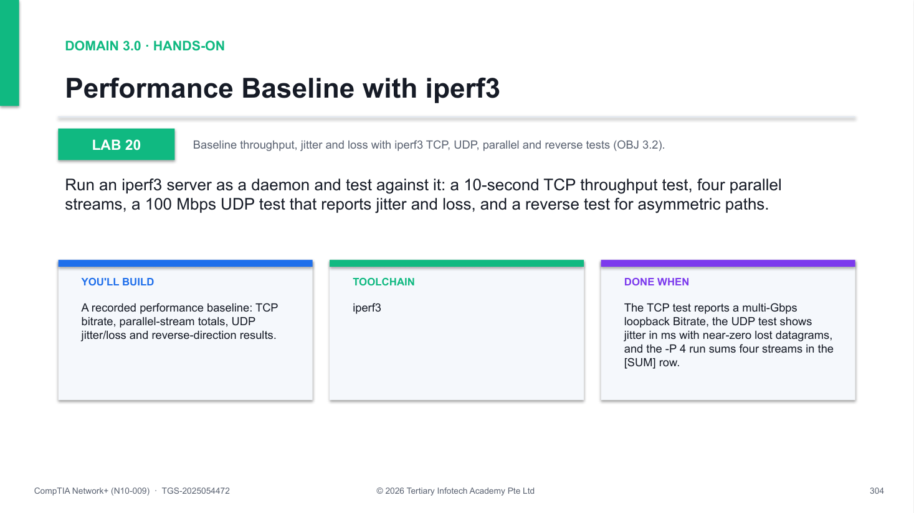

*Figure 20 — how Lab 20 runs: the workflow you will follow.*

**Step-by-step**

1. Install iperf3

   ```bash
   apt update && apt install -y iperf3
   ```

2. Run a server in the background (-s server, -D daemonise)

   ```bash
   iperf3 -s -D
   ```

3. Run a 10-second TCP throughput test and read the Bitrate

   ```bash
   iperf3 -c 127.0.0.1 -t 10
   ```

4. Open four parallel streams to saturate high-latency links

   ```bash
   iperf3 -c 127.0.0.1 -P 4 -t 10
   ```

5. Run a UDP test at 100 Mbps — read Jitter and Lost/Total

   ```bash
   iperf3 -c 127.0.0.1 -u -b 100M -t 10
   ```

6. Reverse mode — server sends to client (asymmetric paths)

   ```bash
   iperf3 -c 127.0.0.1 -R -t 10
   ```

7. Stop the server

   ```bash
   pkill iperf3
   ```


**Test it**

The TCP test reports a multi-Gbps loopback Bitrate, the UDP test shows jitter in ms with near-zero lost datagrams, and the -P 4 run sums four streams in the [SUM] row.

**If it doesn't work**

- Connection refused to 127.0.0.1 — The server is not running — start it again with iperf3 -s -D and confirm with pgrep iperf3.
- Server busy — another test running — Only one client at a time per server; wait for the previous run or pkill iperf3 and restart.
- UDP shows heavy datagram loss — Lower the offered rate (-b 10M) — loss at a set bandwidth is the finding, not an error.

> **Note:** The full lab file with all commands is in labs/lab-20-iperf3/ in the course repository.

---


## Domain 4.0 — Network Security  (14%)

Logical & physical security · deception · terminology · audits & compliance · segmentation · attacks · defence features

**Key concepts**

- Logical security — Encryption in transit/at rest, PKI, IAM, MFA, SSO, RADIUS, LDAP, SAML, TACACS+, least privilege, RBAC and geofencing.
- Physical & deception — Cameras and locks; honeypots and honeynets.
- Terminology & compliance — Risk, vulnerability, exploit, threat, the CIA triad; data locality, PCI DSS and GDPR.
- Segmentation — IoT/IIoT, SCADA/ICS/OT, guest and BYOD network segmentation.
- Attacks — DoS/DDoS, VLAN hopping, MAC flooding, ARP/DNS poisoning and spoofing, rogue devices, evil twin, on-path and social engineering.
- Defence features — Device hardening, NAC, key management, ACLs, URL/content filtering, trusted vs untrusted zones and screened subnets.


### Lab 21 — Host Firewall with UFW

Exam objective: Configure a default-deny host firewall with UFW: global allows, source-restricted rules, rule management.

Goal: Set a deny-by-default inbound policy with UFW, permit SSH globally and MySQL only from 10.0.0.0/8, then list, delete and disable rules to manage the firewall lifecycle.

**What you'll build**

A host firewall that denies all inbound traffic except SSH and source-restricted MySQL.   (Tools: ufw, iptables.)

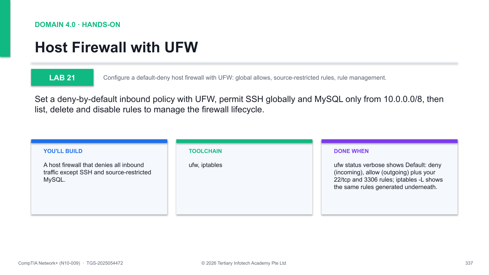

*Figure 21 — how Lab 21 runs: the workflow you will follow.*

**Step-by-step**

1. Install UFW

   ```bash
   apt update && apt install -y ufw
   ```

2. Set deny-by-default inbound and allow outbound

   ```bash
   ufw default deny incoming && ufw default allow outgoing
   ```

3. Allow SSH first - skipping this in a real session locks you out

   ```bash
   ufw allow 22/tcp
   ```

4. Enable the firewall and check the verbose status

   ```bash
   ufw --force enable && ufw status verbose
   ```

5. Add a source-restricted rule: MySQL only from 10.0.0.0/8

   ```bash
   ufw allow from 10.0.0.0/8 to any port 3306 proto tcp
   ```

6. List rules numbered, then delete rule 1

   ```bash
   ufw status numbered && ufw delete 1
   ```

7. Disable the firewall when done

   ```bash
   ufw disable
   ```


**Test it**

ufw status verbose shows Default: deny (incoming), allow (outgoing) plus your 22/tcp and 3306 rules; iptables -L shows the same rules generated underneath.

**If it doesn't work**

- Locked out of SSH — Always allow 22/tcp before ufw enable; from the console run ufw disable, re-add the rule, re-enable
- Rule never matches — Check order with ufw status numbered - more specific source rules must sit above broad ones
- ufw: command not found — Install it first: apt update && apt install -y ufw

> **Note:** The full lab file with all commands is in labs/lab-21-host-firewall/ in the course repository.

---


### Lab 22 — TLS Certificate with OpenSSL and Nginx

Exam objective: Generate a self-signed X.509 certificate, serve HTTPS from nginx and inspect the TLS handshake.

Goal: Create an RSA-2048 self-signed certificate with openssl req -x509, configure nginx for HTTPS on 443, then verify the handshake and certificate fields from the client with curl, openssl x509 and s_client.

**What you'll build**

An HTTPS server on 443 presenting your own certificate, plus a client-side view of the TLS 1.3 handshake.   (Tools: openssl, nginx, curl.)

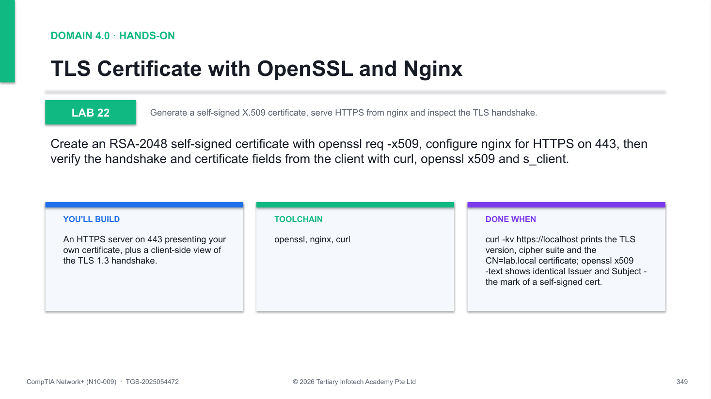

*Figure 22 — how Lab 22 runs: the workflow you will follow.*

**Step-by-step**

1. Install the packages

   ```bash
   apt update && apt install -y openssl nginx curl
   ```

2. Generate a self-signed RSA-2048 cert and key (add -days 365 for one year)

   ```bash
   openssl req -x509 -newkey rsa:2048 -nodes -keyout lab.key -out lab.crt -subj /CN=lab.local
   ```

3. Point nginx at the cert and key (listen 443 ssl) and restart

   ```bash
   systemctl restart nginx
   ```

4. Test the TLS handshake from the client (-k accepts self-signed)

   ```bash
   curl -kv https://localhost 2>&1 | head -30
   ```

5. Inspect the certificate: Issuer, Subject, validity, public key

   ```bash
   openssl x509 -in lab.crt -noout -text | head -20
   ```

6. Probe the live handshake with s_client

   ```bash
   echo | openssl s_client -connect localhost:443 -servername lab.local 2>/dev/null | head -20
   ```


**Test it**

curl -kv https://localhost prints the TLS version, cipher suite and the CN=lab.local certificate; openssl x509 -text shows identical Issuer and Subject - the mark of a self-signed cert.

**If it doesn't work**

- curl: SSL certificate problem — Expected for self-signed - pass -k to curl, or install a CA-signed certificate instead
- nginx fails to restart — Run nginx -t to locate the config error; verify the ssl_certificate and key paths exist
- Nothing listening on 443 — Confirm listen 443 ssl in the server block, then check with ss -tlnp | grep 443

> **Note:** The full lab file with all commands is in labs/lab-22-tls-certificate/ in the course repository.

---


### Lab 23 — SSH Hardening with Key Authentication

Exam objective: Harden SSH: Ed25519 key authentication, password login disabled, config validated before reload.

Goal: Generate an Ed25519 key pair, install the public key in authorized_keys, prove key login works, then disable PasswordAuthentication in sshd_config, validate with sshd -t and confirm password login is refused.

**What you'll build**

An SSH daemon that accepts only public-key authentication, with root password login prohibited.   (Tools: openssh-server, openssh-client, ssh-keygen.)

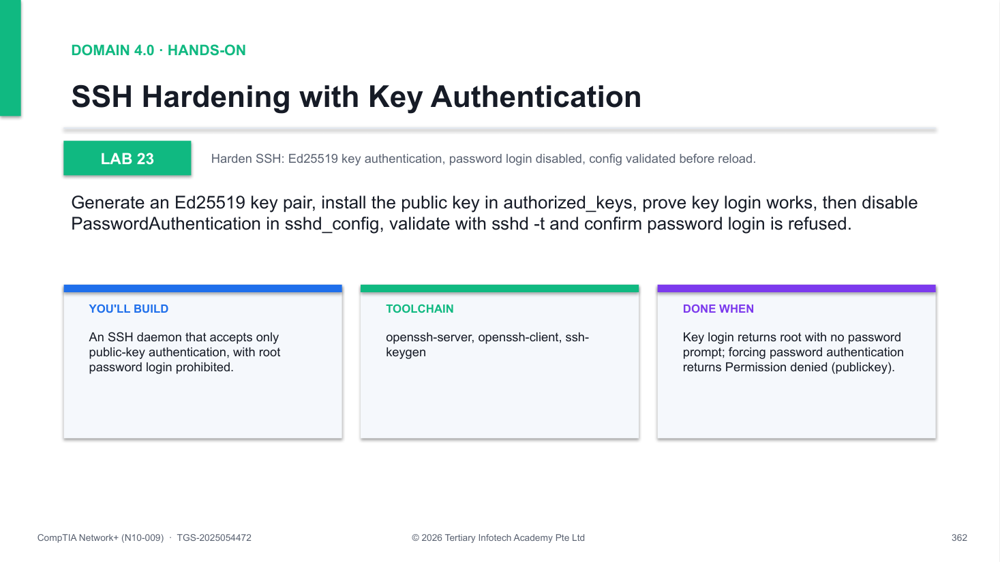

*Figure 23 — how Lab 23 runs: the workflow you will follow.*

**Step-by-step**

1. Generate an Ed25519 key pair (modern elliptic-curve algorithm)

   ```bash
   ssh-keygen -t ed25519 -N '' -f ~/.ssh/lab_ed25519
   ```

2. Install the public key as authorised and lock down permissions

   ```bash
   cat ~/.ssh/lab_ed25519.pub >> ~/.ssh/authorized_keys && chmod 600 ~/.ssh/authorized_keys
   ```

3. Test key-based login - no password prompt should appear

   ```bash
   ssh -i ~/.ssh/lab_ed25519 -o StrictHostKeyChecking=no root@localhost whoami
   ```

4. Disable password authentication in sshd_config

   ```bash
   sed -i 's/^#*PasswordAuthentication.*/PasswordAuthentication no/' /etc/ssh/sshd_config
   ```

5. Validate the config, then reload - never reload untested

   ```bash
   sshd -t && systemctl reload ssh
   ```

6. Verify password login is now refused

   ```bash
   ssh -o PreferredAuthentications=password -o PubkeyAuthentication=no root@localhost
   ```

7. Discuss bonus hardening: Port 2222, AllowUsers, MaxAuthTries 3, fail2ban

**Test it**

Key login returns root with no password prompt; forcing password authentication returns Permission denied (publickey).

**If it doesn't work**

- Permission denied with the key — Fix permissions: chmod 700 ~/.ssh and chmod 600 ~/.ssh/authorized_keys - sshd refuses lax modes
- sshd -t reports errors — Fix the reported line in /etc/ssh/sshd_config before reloading - a bad config can lock you out
- Password login still works — Check override files in /etc/ssh/sshd_config.d/ for PasswordAuthentication yes, then reload ssh

> **Note:** The full lab file with all commands is in labs/lab-23-ssh-hardening/ in the course repository.

---


### Lab 24 — Site-to-Site VPN with WireGuard

Exam objective: Build a site-to-site WireGuard tunnel between two network namespaces and verify the handshake.

Goal: Create two namespaces as VPN endpoints, generate Curve25519 key pairs, configure wg0 interfaces with peer public keys and allowed-ips, bring the tunnel up, ping across it and inspect handshake state with wg show.

**What you'll build**

An encrypted point-to-point tunnel (10.99.0.1 <-> 10.99.0.2) between two namespaces acting as two sites.   (Tools: wireguard, wireguard-tools, iproute2.)

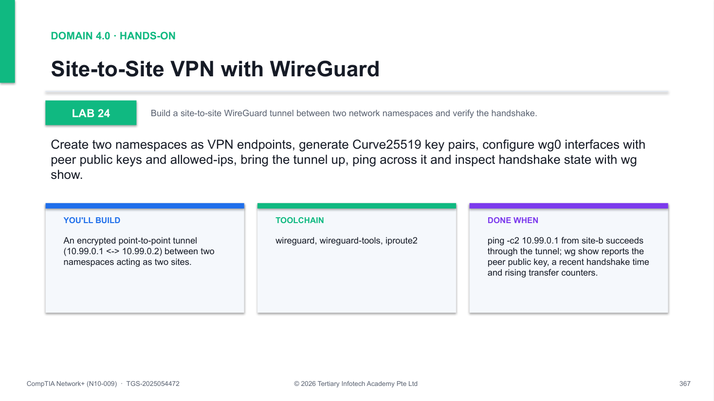

*Figure 24 — how Lab 24 runs: the workflow you will follow.*

**Step-by-step**

1. Install WireGuard

   ```bash
   apt update && apt install -y wireguard wireguard-tools
   ```

2. Create two namespaces representing the two sites

   ```bash
   ip netns add site-a && ip netns add site-b
   ```

3. Generate a key pair for each peer (repeat for b.key/b.pub)

   ```bash
   wg genkey | tee a.key | wg pubkey > a.pub
   ```

4. Create a wg0 WireGuard interface in each namespace

   ```bash
   ip -n site-a link add wg0 type wireguard
   ```

5. Assign the tunnel addresses 10.99.0.1/24 and 10.99.0.2/24

   ```bash
   ip -n site-a addr add 10.99.0.1/24 dev wg0
   ```

6. Set private key, listen port and peer allowed-ips on both sides

   ```bash
   ip netns exec site-a wg set wg0 private-key /tmp/a.key listen-port 51820
   ```

7. Bring both tunnel interfaces up

   ```bash
   ip -n site-a link set wg0 up && ip -n site-b link set wg0 up
   ```

8. Ping site-a across the encrypted tunnel from site-b

   ```bash
   ip netns exec site-b ping -c2 10.99.0.1
   ```

9. Inspect the peer public key, last handshake and byte counters

   ```bash
   ip netns exec site-a wg show
   ```

10. Clean up namespaces and key files

   ```bash
   ip netns del site-a && ip netns del site-b
   ```


**Test it**

ping -c2 10.99.0.1 from site-b succeeds through the tunnel; wg show reports the peer public key, a recent handshake time and rising transfer counters.

**If it doesn't work**

- Ping fails across the tunnel — Check wg show for a handshake; verify each peer entry uses the other side's PUBLIC key
- wg show shows no handshake — Confirm site-b's endpoint 127.0.0.1:51820 matches site-a's listen-port, and allowed-ips cover the peer /32
- wg0 already exists — Stale run - delete with ip netns del site-a && ip netns del site-b and recreate

> **Note:** The full lab file with all commands is in labs/lab-24-wireguard-vpn/ in the course repository.

---


### Lab 25 — Port Scanning and Service Hardening

Exam objective: Enumerate exposed services with nmap and reduce the attack surface by disabling what is unneeded.

Goal: SYN-scan all 65535 TCP ports on your own host, identify service versions and the OS, cross-check each open port against ss -tulnp, disable an unnecessary service and re-scan to confirm the port is closed.

**What you'll build**

A port-by-port inventory of your host's attack surface, with an unneeded service disabled and verified closed.   (Tools: nmap, ss, systemctl.)

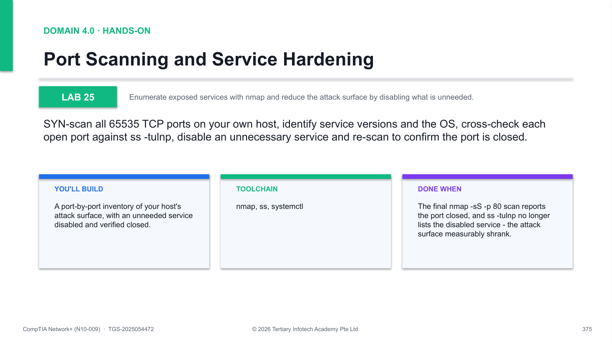

*Figure 25 — how Lab 25 runs: the workflow you will follow.*

**Step-by-step**

1. Install nmap

   ```bash
   apt update && apt install -y nmap
   ```

2. SYN-scan (half-open, -sS) all 65535 TCP ports on localhost

   ```bash
   nmap -sS -p- 127.0.0.1
   ```

3. Enumerate service versions (-sV probes banners) on key ports

   ```bash
   nmap -sV -p 22,80,443 127.0.0.1
   ```

4. Fingerprint the operating system (requires root)

   ```bash
   nmap -O 127.0.0.1
   ```

5. Cross-check every open port against its owning process

   ```bash
   ss -tulnp
   ```

6. Disable an unneeded service - ask: do I need this running?

   ```bash
   systemctl disable --now apache2
   ```

7. Re-scan to confirm the port is now closed

   ```bash
   nmap -sS -p 80 127.0.0.1
   ```


**Test it**

The final nmap -sS -p 80 scan reports the port closed, and ss -tulnp no longer lists the disabled service - the attack surface measurably shrank.

**If it doesn't work**

- Scan takes very long — -p- probes 65535 ports; in the lab scan a shortlist such as -p 1-1024 instead
- nmap -O gives no result — OS fingerprinting needs root privileges and at least one open and one closed port
- Port still open after disable — Another process owns it - find the PID with ss -tulnp and stop that unit too

> **Note:** The full lab file with all commands is in labs/lab-25-port-scanning/ in the course repository.

---


### Lab 26 — Intrusion Detection with Suricata

Exam objective: Run Suricata as an IDS, trigger a known signature and read the alert in fast.log and eve.json.

Goal: Install Suricata, pull the Emerging Threats ruleset, start the engine on eth0, generate benign trigger traffic from testmynids.org, then trace the resulting alert through fast.log and the JSON eve.json event stream.

**What you'll build**

A live IDS on eth0 with a current ET ruleset, plus a captured alert you can parse as JSON with jq.   (Tools: suricata, suricata-update, jq, curl, TIS Cybersecurity Simulator.)

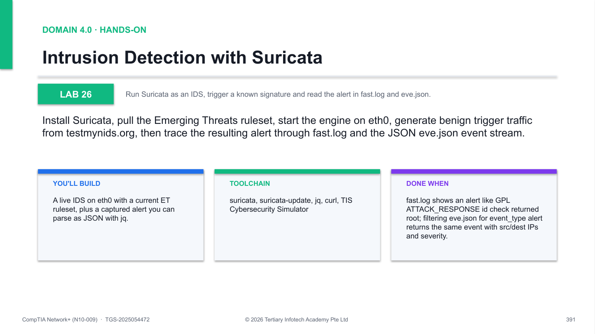

*Figure 26 — how Lab 26 runs: the workflow you will follow.*

**Step-by-step**

1. Install Suricata and jq

   ```bash
   apt update && apt install -y suricata jq
   ```

2. Update the Emerging Threats community ruleset

   ```bash
   suricata-update
   ```

3. Start Suricata as a daemon (-D) on the active interface

   ```bash
   suricata -i eth0 -D
   ```

4. Confirm the engine started cleanly

   ```bash
   tail /var/log/suricata/suricata.log
   ```

5. Trigger a well-known test signature via the NIDS test page

   ```bash
   curl -s http://testmynids.org/uid/index.html >/dev/null
   ```

6. Inspect the alert in the human-readable fast.log

   ```bash
   tail /var/log/suricata/fast.log
   ```

7. Filter the same alert from the eve.json event stream with jq

   ```bash
   cat /var/log/suricata/eve.json | jq 'select(.event_type=="alert")' | head -20
   ```

8. Run the TIS Cybersecurity Simulator network-attack scenarios to see IDS traffic patterns
9. Stop Suricata

   ```bash
   pkill suricata
   ```


**Test it**

fast.log shows an alert like GPL ATTACK_RESPONSE id check returned root; filtering eve.json for event_type alert returns the same event with src/dest IPs and severity.

**If it doesn't work**

- No alerts appear — Confirm Suricata listens on the right interface (check ip a), then re-run the testmynids curl
- suricata-update fails — Check Internet access - the rules download from the Emerging Threats feed
- eve.json is empty — Give the engine a few seconds after the trigger; check suricata.log for startup errors

> **Note:** The full lab file with all commands is in labs/lab-26-suricata-ids/ in the course repository.

---


### Lab 27 — Building an ACL with iptables

Exam objective: Build an ordered iptables ACL that permits MySQL from one subnet and drops it from everywhere else.

Goal: Insert an ACCEPT rule for TCP 3306 from 10.0.0.0/24 above an appended DROP, verify ordering with --line-numbers, test both paths with nc from allowed and blocked sources, then persist the rules across reboots.

**What you'll build**

A working two-rule ACL on the INPUT chain proving top-down, first-match evaluation, saved to survive reboot.   (Tools: iptables, netcat, iptables-persistent.)

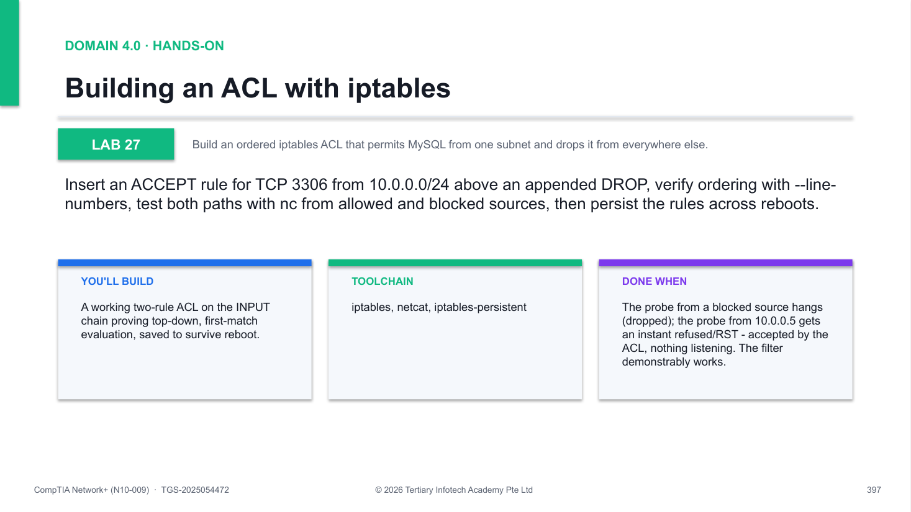

*Figure 27 — how Lab 27 runs: the workflow you will follow.*

**Step-by-step**

1. Inspect the current INPUT chain (default policy is ACCEPT)

   ```bash
   iptables -L INPUT -n -v --line-numbers
   ```

2. Insert (-I, at the top) an ACCEPT for MySQL from 10.0.0.0/24

   ```bash
   iptables -I INPUT -p tcp --dport 3306 -s 10.0.0.0/24 -j ACCEPT
   ```

3. Append (-A, at the bottom) a DROP for MySQL from everywhere else

   ```bash
   iptables -A INPUT -p tcp --dport 3306 -j DROP
   ```

4. Verify ordering - the ACCEPT must sit above the DROP

   ```bash
   iptables -L INPUT -n -v --line-numbers
   ```

5. Test from a blocked source: the DROP swallows the probe

   ```bash
   nc -zv 127.0.0.1 3306
   ```

6. Add an allowed source address and retest from it

   ```bash
   ip addr add 10.0.0.5/24 dev lo && nc -zv -s 10.0.0.5 127.0.0.1 3306
   ```

7. Persist the rules so they survive reboot

   ```bash
   apt install -y iptables-persistent && netfilter-persistent save
   ```

8. Clean up: delete both rules and the extra address

   ```bash
   iptables -D INPUT -p tcp --dport 3306 -j DROP
   ```


**Test it**

The probe from a blocked source hangs (dropped); the probe from 10.0.0.5 gets an instant refused/RST - accepted by the ACL, nothing listening. The filter demonstrably works.

**If it doesn't work**

- ACL never blocks anything — The ACCEPT may sit below the DROP - first match wins; verify order with --line-numbers
- Rules vanish after reboot — Install iptables-persistent and run netfilter-persistent save to write /etc/iptables/rules.v4
- nc test looks inconclusive — With no MySQL listening, allowed sources see instant RST (refused); dropped sources see a timeout

> **Note:** The full lab file with all commands is in labs/lab-27-iptables-acl/ in the course repository.

---


## Domain 5.0 — Network Troubleshooting  (24%)

Methodology · cabling & physical interfaces · network services · performance · tools

**Key concepts**

- Methodology — Identify the problem → establish a theory → test → plan and implement → verify → document findings.
- Cabling & interface issues — Incorrect cable type, signal degradation, improper termination, TX/RX transposed, error counters, port status, PoE and transceiver mismatch.
- Network service issues — STP problems, VLAN assignment, ACLs, routing-table and default-route faults, address-pool exhaustion, wrong gateway/IP/mask.
- Performance issues — Congestion, latency, packet loss and wireless interference.
- Tools & protocols — Protocol analyzers, command-line tools, cable testers and Wi-Fi analyzers.


### Lab 28 — Layer 1/2 Diagnostics with ip and ethtool

Exam objective: Diagnose cable and interface faults from link state, speed/duplex and error counters.

Goal: Use ip and ethtool on a Killercoda Ubuntu VM to read interface state, verify speed and duplex, hunt CRC and frame error counters, and bounce a NIC to recover the link.

**What you'll build**

A verified eth0: link state decoded, speed/duplex confirmed and every error counter read and interpreted.   (Tools: ethtool, iproute2, Killercoda Ubuntu playground.)

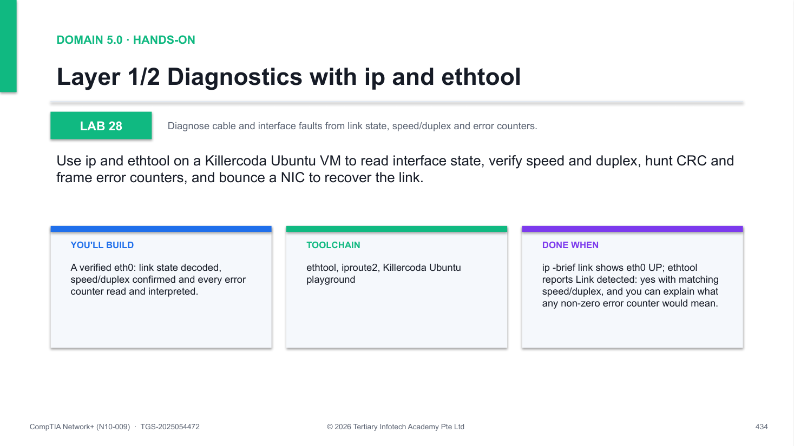

*Figure 28 — how Lab 28 runs: the workflow you will follow.*

**Step-by-step**

1. Install ethtool

   ```bash
   apt update && apt install -y ethtool
   ```

2. Check the operational state of all NICs

   ```bash
   ip -brief link show
   ```

3. Inspect link speed, duplex and carrier

   ```bash
   ethtool eth0
   ```

4. Read the driver error counters

   ```bash
   ethtool -S eth0 | grep -iE 'err|drop|crc|frame'
   ```

5. Read kernel-level RX/TX statistics

   ```bash
   ip -s link show eth0
   ```

6. Bounce the interface and re-check

   ```bash
   ip link set eth0 down && sleep 1 && ip link set eth0 up
   ```

7. Note how speed/duplex would be forced (do not run)

   ```bash
   # ethtool -s eth0 speed 1000 duplex full autoneg off
   ```


**Test it**

ip -brief link shows eth0 UP; ethtool reports Link detected: yes with matching speed/duplex, and you can explain what any non-zero error counter would mean.

**If it doesn't work**

- ethtool: command not found — Run apt update && apt install -y ethtool first.
- State shows LOWERLAYERDOWN — No carrier - in the real world check the cable/SFP; in the lab bring it up with ip link set eth0 up.
- Counters show no errors — Normal on a clean virtual NIC - the skill is knowing where CRC and frame errors would appear.

> **Note:** The full lab file with all commands is in labs/lab-28-layer1-2-diagnostics/ in the course repository.

---


### Lab 29 — Reachability with ping, traceroute and mtr

Exam objective: Localise latency and packet loss along a network path with ping, traceroute and mtr.

Goal: Baseline RTT and loss with ping, expose every L3 hop with traceroute, combine both views in a 20-cycle mtr report, then bypass ICMP filters with a TCP traceroute on port 443.

**What you'll build**

An mtr loss report for 8.8.8.8 and a TCP traceroute that passes firewalls which block ICMP.   (Tools: iputils-ping, traceroute, mtr-tiny.)

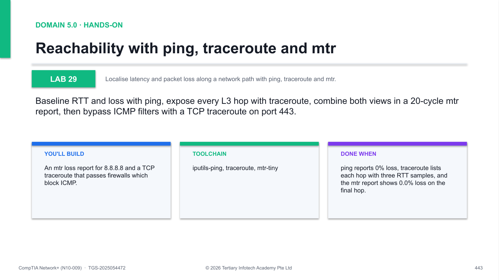

*Figure 29 — how Lab 29 runs: the workflow you will follow.*

**Step-by-step**

1. Install the tools

   ```bash
   apt update && apt install -y traceroute mtr-tiny
   ```

2. Baseline RTT and loss with ping

   ```bash
   ping -c5 8.8.8.8
   ```

3. Trace the hop-by-hop path

   ```bash
   traceroute 8.8.8.8
   ```

4. Run a 20-cycle mtr report

   ```bash
   mtr -rwc 20 8.8.8.8
   ```

5. Read the Loss% column - find where loss starts and whether it persists
6. Use TCP traceroute where ICMP is blocked

   ```bash
   traceroute -T -p 443 example.com
   ```


**Test it**

ping reports 0% loss, traceroute lists each hop with three RTT samples, and the mtr report shows 0.0% loss on the final hop.

**If it doesn't work**

- traceroute prints * * * — That hop drops ICMP/UDP probes - usually filtered, not broken; try traceroute -T -p 443 instead.
- mtr: command not found — Install the report-mode build with apt install -y mtr-tiny.
- Loss shown on one middle hop only — ICMP rate-limiting on that router - only loss persisting to the final hop is real.

> **Note:** The full lab file with all commands is in labs/lab-29-ping-traceroute-mtr/ in the course repository.

---


### Lab 30 — DNS Troubleshooting with dig and resolvectl

Exam objective: Isolate DNS faults by comparing resolvers, tracing delegation and reading response codes.

Goal: Identify which resolver the system really uses, compare answers from 1.1.1.1 and 8.8.8.8, walk the delegation chain with dig +trace, time a lookup and flush the systemd-resolved cache.

**What you'll build**

A decoded dig +trace delegation chain plus a flushed resolver cache and the NXDOMAIN/SERVFAIL/REFUSED decode.   (Tools: dnsutils (dig), systemd-resolved (resolvectl).)

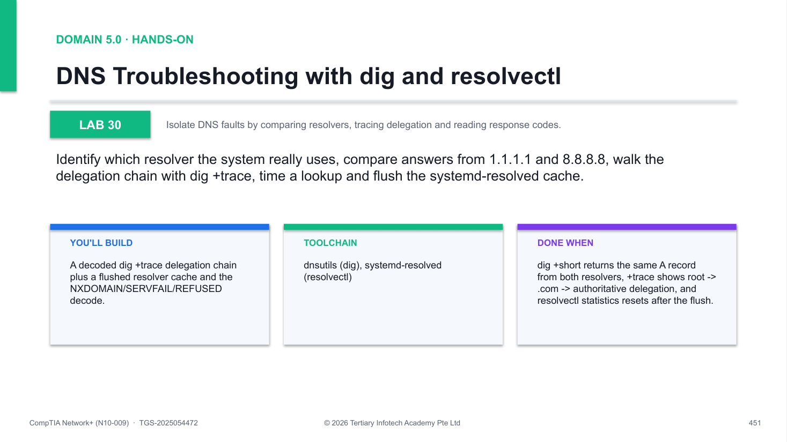

*Figure 30 — how Lab 30 runs: the workflow you will follow.*

**Step-by-step**

1. Install dnsutils

   ```bash
   apt update && apt install -y dnsutils
   ```

2. Confirm which resolver the system is using

   ```bash
   cat /etc/resolv.conf && resolvectl status | head -20
   ```

3. Compare two upstream resolvers

   ```bash
   dig @1.1.1.1 example.com +short && dig @8.8.8.8 example.com +short
   ```

4. Trace the recursive resolution chain

   ```bash
   dig +trace example.com
   ```

5. Time a lookup to spot a slow upstream

   ```bash
   time dig @1.1.1.1 example.com
   ```

6. Flush the cache and confirm the statistics reset

   ```bash
   resolvectl flush-caches && resolvectl statistics
   ```


**Test it**

dig +short returns the same A record from both resolvers, +trace shows root -> .com -> authoritative delegation, and resolvectl statistics resets after the flush.

**If it doesn't work**

- resolv.conf points to 127.0.0.53 — Expected - systemd-resolved proxies DNS; use resolvectl status to see the real upstream.
- SERVFAIL from one resolver — Upstream or DNSSEC failure - compare against a second resolver to confirm it is server-side.
- dig +trace hangs — Some networks block outbound DNS to the root servers; rerun on the Killercoda VM.

> **Note:** The full lab file with all commands is in labs/lab-30-dns-troubleshooting/ in the course repository.

---


### Lab 31 — ARP and the IPv6 Neighbour Table

Exam objective: Diagnose L2 adjacency problems with ip neigh and arping, including duplicate IP detection.

Goal: View and decode neighbour states, probe the default gateway with arping, run duplicate-address detection on your own IP, pin and flush ARP entries, then inspect IPv6 neighbour discovery.

**What you'll build**

A decoded neighbour table with a static entry added and flushed, plus a duplicate-IP probe of your own address.   (Tools: iputils-arping, iproute2, ndisc6.)

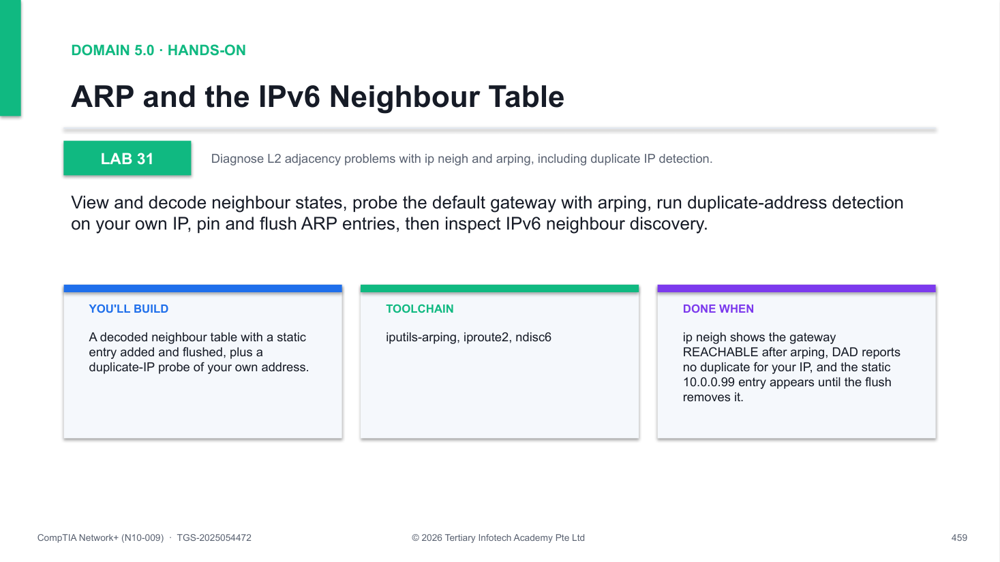

*Figure 31 — how Lab 31 runs: the workflow you will follow.*

**Step-by-step**

1. Install arping

   ```bash
   apt update && apt install -y iputils-arping
   ```

2. View the neighbour table and its states

   ```bash
   ip neigh
   ```

3. Probe the default gateway directly with ARP

   ```bash
   arping -I eth0 -c2 $(ip route | awk '/default/ {print $3}')
   ```

4. Run duplicate address detection on your own IP

   ```bash
   arping -D -I eth0 -c2 $(ip -4 -o addr show eth0 | awk '{print $4}' | cut -d/ -f1)
   ```

5. Add a static ARP entry and verify it

   ```bash
   ip neigh add 10.0.0.99 lladdr de:ad:be:ef:00:01 dev eth0
   ```

6. Flush the table and watch it repopulate

   ```bash
   ip neigh flush all && ip neigh
   ```

7. Inspect IPv6 neighbour discovery

   ```bash
   ip -6 neigh
   ```


**Test it**

ip neigh shows the gateway REACHABLE after arping, DAD reports no duplicate for your IP, and the static 10.0.0.99 entry appears until the flush removes it.

**If it doesn't work**

- arping: Operation not permitted — ARP probes need raw sockets - run as root (Killercoda terminals already are).
- All entries show STALE — Normal - STALE means known but unconfirmed; traffic or arping promotes it to REACHABLE.
- DAD says address already in use — Another host claims your IP - a real duplicate-IP incident; hunt it down by its MAC address.

> **Note:** The full lab file with all commands is in labs/lab-31-arp-neighbor/ in the course repository.

---


### Lab 32 — Packet Capture with tcpdump and TIS PCAP Analyzer

Exam objective: Capture DNS traffic to a .pcap and analyse it with tshark and the TIS PCAP Analyzer.

Goal: Capture ten DNS packets with a BPF capture filter, dissect them with tshark display filters, then move the .pcap to your laptop and explore it graphically in the browser-based TIS PCAP Analyzer.

**What you'll build**

A dns.pcap captured with tcpdump and read three ways: tcpdump summary, tshark fields and the TIS PCAP Analyzer UI.   (Tools: tcpdump, tshark, TIS PCAP Analyzer (alfredang.github.io/pcapanalyzer).)

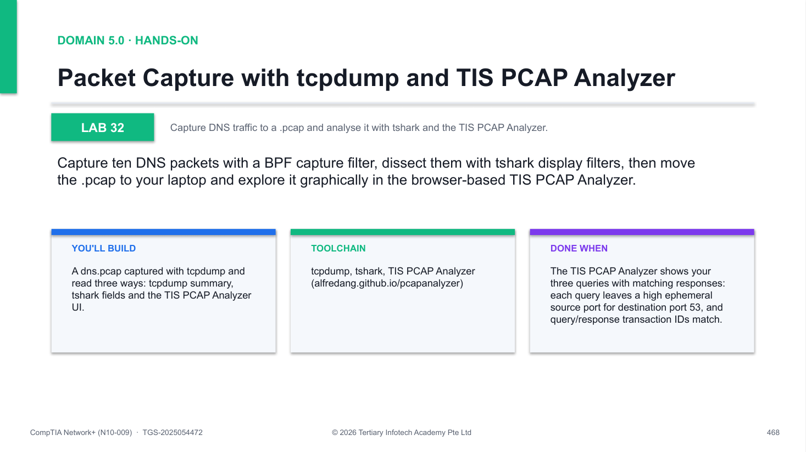

*Figure 32 — how Lab 32 runs: the workflow you will follow.*

**Step-by-step**

1. Install the capture tools

   ```bash
   apt update && apt install -y tcpdump tshark
   ```

2. Start a 10-packet DNS capture in the background

   ```bash
   tcpdump -i eth0 -nn -w /tmp/dns.pcap 'udp port 53' -c 10 &
   ```

3. Generate DNS queries to fill the capture

   ```bash
   for d in example.com cloudflare.com github.com; do dig +short @1.1.1.1 $d; done
   ```

4. Extract query names and types with tshark

   ```bash
   tshark -r /tmp/dns.pcap -Y dns -T fields -e dns.qry.name -e dns.qry.type
   ```

5. Show only the response packets

   ```bash
   tshark -r /tmp/dns.pcap -Y 'dns.flags.response==1'
   ```

6. Print a human-readable summary

   ```bash
   tcpdump -nn -r /tmp/dns.pcap | head
   ```

7. Base64 the pcap so you can copy it to your laptop

   ```bash
   base64 /tmp/dns.pcap > /tmp/dns.pcap.b64 && cat /tmp/dns.pcap.b64
   ```

8. Open https://alfredang.github.io/pcapanalyzer/ and upload dns.pcap
9. Answer the analysis questions: query ports, transaction IDs, record types

**Test it**

The TIS PCAP Analyzer shows your three queries with matching responses: each query leaves a high ephemeral source port for destination port 53, and query/response transaction IDs match.

**If it doesn't work**

- Capture never reaches 10 packets — Your queries may not match the BPF filter - re-run the dig loop or loosen the filter.
- tshark asks about non-root capture — Answer No for the lab - you are reading files, not capturing as a normal user.
- Analyzer shows no packets — Re-decode the base64 on your laptop (base64 -d dns.pcap.b64 > dns.pcap) and upload again.

> **Note:** The full lab file with all commands is in labs/lab-32-packet-capture/ in the course repository.

---


### Lab 33 — MTU and Path-MTU Discovery

Exam objective: Demonstrate MTU limits with DF-bit pings and explain PMTUD black holes and MSS clamping.

Goal: Compute the ICMP payload maths (MTU minus 28), send Don't-Fragment pings at and over the limit, lower the interface MTU to 1400 and retest both sides of the new limit, then restore it.

**What you'll build**

A demonstrated 1472-byte pass / 1500-byte 'message too long' fail, repeated at MTU 1400, and a restored interface.   (Tools: iputils-ping, iproute2.)

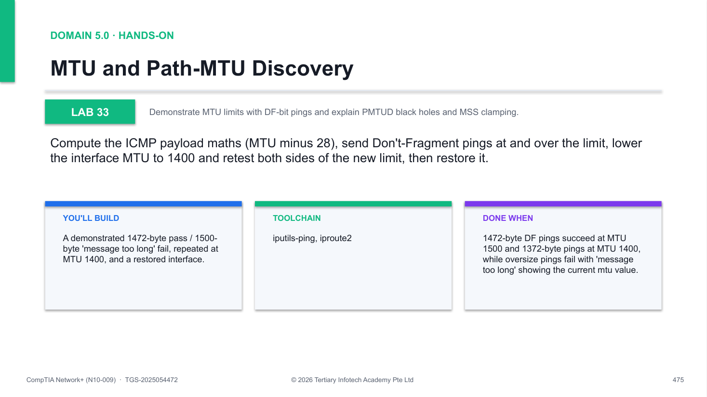

*Figure 33 — how Lab 33 runs: the workflow you will follow.*

**Step-by-step**

1. Check the interface MTU

   ```bash
   ip -brief link show eth0
   ```

2. Ping with the largest payload that fits (1500 - 28)

   ```bash
   ping -M do -s 1472 -c2 8.8.8.8
   ```

3. Exceed the MTU with DF set and read the error

   ```bash
   ping -M do -s 1500 -c2 8.8.8.8
   ```

4. Lower the interface MTU to 1400

   ```bash
   ip link set eth0 mtu 1400
   ```

5. Retest at the new limit (1400 - 28 = 1372)

   ```bash
   ping -M do -s 1372 -c2 8.8.8.8
   ```

6. Restore the standard MTU

   ```bash
   ip link set eth0 mtu 1500
   ```

7. Discuss: why ICMP filtering breaks PMTUD and how MSS clamping fixes TCP

**Test it**

1472-byte DF pings succeed at MTU 1500 and 1372-byte pings at MTU 1400, while oversize pings fail with 'message too long' showing the current mtu value.

**If it doesn't work**

- Oversize ping shows no error — Without -M do the kernel silently fragments - the DF bit is what makes the test honest.
- 1472 fails too — A tunnel/VPN lowers the effective path MTU - step the size down (1452, 1420...) until it passes.
- Forgot to restore the MTU — ip link set eth0 mtu 1500 - a lowered MTU otherwise slows every later lab.

> **Note:** The full lab file with all commands is in labs/lab-33-mtu-pmtud/ in the course repository.

---


### Lab 34 — Diagnosing Routing Problems

Exam objective: Read and manipulate the routing table; prove which route a destination uses with ip route get.

Goal: Print the routing table, query the kernel's route choice for two destinations, add a static route with a metric, inspect precedence and longest-prefix match, then remove the test route.

**What you'll build**

A routing table with a temporary 10.99.0.0/24 static route, proven with ip route get and cleanly removed.   (Tools: iproute2, traceroute.)

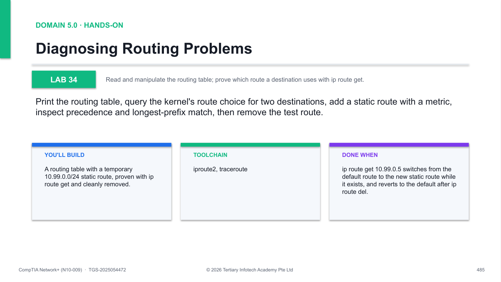

*Figure 34 — how Lab 34 runs: the workflow you will follow.*

**Step-by-step**

1. Print the full routing table

   ```bash
   ip route
   ```

2. Ask the kernel which route a destination uses

   ```bash
   ip route get 8.8.8.8 && ip route get 10.99.0.5
   ```

3. Add a static route via the default gateway

   ```bash
   ip route add 10.99.0.0/24 via $(ip route | awk '/default/ {print $3}') metric 100
   ```

4. Show the new route and its metric

   ```bash
   ip route show 10.99.0.0/24
   ```

5. Re-run ip route get and watch the choice change

   ```bash
   ip route get 10.99.0.5
   ```

6. Compare outbound paths to discuss asymmetric routing

   ```bash
   traceroute 8.8.8.8
   ```

7. Remove the test route

   ```bash
   ip route del 10.99.0.0/24
   ```


**Test it**

ip route get 10.99.0.5 switches from the default route to the new static route while it exists, and reverts to the default after ip route del.

**If it doesn't work**

- RTNETLINK: file exists — The route is already present - delete it first with ip route del 10.99.0.0/24.
- Route added but not used — A longer prefix elsewhere wins - longest-prefix match beats metric every time.
- No default route at all — Re-add it: ip route add default via <gateway IP> dev eth0.

> **Note:** The full lab file with all commands is in labs/lab-34-routing-issues/ in the course repository.

---


### Lab 35 — Simulating Slow and Lossy Links with tc

Exam objective: Reproduce WAN latency, jitter and loss with tc netem and cap bandwidth with tbf.

Goal: Baseline RTT, then use tc netem to inject 200 ms delay, +/-50 ms jitter and 5% loss, verifying each with ping; cap throughput at 1 Mbit/s with tbf, prove it with iperf3, then remove all shaping.

**What you'll build**

A NIC that demonstrably ran at +200 ms delay, 5% loss and a 1 Mbit/s cap - and a clean qdisc afterwards.   (Tools: iproute2 (tc/netem/tbf), iperf3.)


*Figure 35 — how Lab 35 runs: the workflow you will follow.*

**Step-by-step**

1. Baseline the RTT

   ```bash
   ping -c5 8.8.8.8
   ```

2. Add 200 ms of delay and re-ping

   ```bash
   tc qdisc add dev eth0 root netem delay 200ms && ping -c5 8.8.8.8
   ```

3. Add +/-50 ms of jitter

   ```bash
   tc qdisc change dev eth0 root netem delay 200ms 50ms distribution normal
   ```

4. Add 5% packet loss and count the timeouts

   ```bash
   tc qdisc change dev eth0 root netem delay 200ms loss 5% && ping -c20 8.8.8.8
   ```

5. Clear netem before shaping bandwidth

   ```bash
   tc qdisc del dev eth0 root
   ```

6. Cap bandwidth at 1 Mbit/s with a token bucket

   ```bash
   tc qdisc add dev eth0 root tbf rate 1mbit burst 32kbit latency 400ms
   ```

7. Prove the cap with iperf3

   ```bash
   apt install -y iperf3 && iperf3 -s -D && iperf3 -c 127.0.0.1 -t 5
   ```

8. Remove all shaping and confirm recovery

   ```bash
   tc qdisc del dev eth0 root && ping -c3 8.8.8.8
   ```


**Test it**

ping RTT rises by about 200 ms under netem, roughly 1 in 20 pings times out at 5% loss, and iperf3 reports about 1 Mbit/s under the tbf cap.

**If it doesn't work**

- RTNETLINK answers: file exists — A qdisc is already installed - use tc qdisc change, or delete the root qdisc first.
- RTT did not change — You shaped the wrong interface - confirm the active NIC with ip -brief link.
- iperf3 connection refused — Start the server first (iperf3 -s -D), then run the client against 127.0.0.1.

> **Note:** The full lab file with all commands is in labs/lab-35-tc-network-emulation/ in the course repository.

---


### Lab 36 — Service Reachability Triage with curl, nc and openssl

Exam objective: Isolate a 'site is down' report to TCP, TLS, HTTP or the app using nc, openssl and curl.

Goal: Walk the layered triage: prove the TCP handshake with nc -zv, validate the certificate chain with openssl s_client, read HTTP status codes with curl -v, then break one request into DNS/TCP/TLS/TTFB timings.

**What you'll build**

A complete layer-by-layer triage of example.com:443 with a timing breakdown that names the slow phase.   (Tools: curl, netcat-openbsd, openssl.)

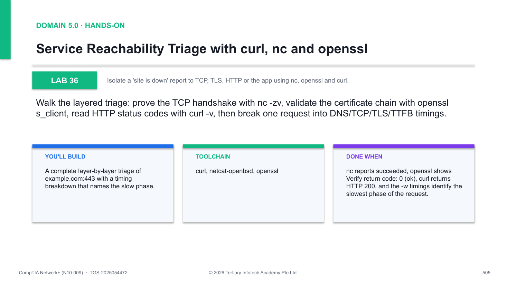

*Figure 36 — how Lab 36 runs: the workflow you will follow.*

**Step-by-step**

1. Install the triage tools

   ```bash
   apt update && apt install -y curl netcat-openbsd openssl
   ```

2. Test L4: the TCP handshake only

   ```bash
   nc -zv example.com 443
   ```

3. Test L6: TLS handshake and certificate

   ```bash
   echo | openssl s_client -connect example.com:443 -servername example.com | head -20
   ```

4. Check subject, issuer and 'Verify return code: 0 (ok)'
5. Test L7: the HTTP status code

   ```bash
   curl -v https://example.com 2>&1 | head -30
   ```

6. Break the request into timing phases

   ```bash
   curl -so /dev/null -w 'DNS:%{time_namelookup} TTFB:%{time_starttransfer}' https://example.com
   ```

7. Apply the decision tree: which layer failed, and who owns the fix?

**Test it**

nc reports succeeded, openssl shows Verify return code: 0 (ok), curl returns HTTP 200, and the -w timings identify the slowest phase of the request.

**If it doesn't work**

- nc hangs then times out — No TCP path - fall back to Lab 29 tools: check DNS, then mtr the host, then firewalls.
- Verify return code is non-zero — Expired or untrusted certificate, or SNI mismatch - re-run with the right -servername.
- HTTP 502/503/504 — TCP and TLS are fine - the fault is the app or its upstream; escalate with your evidence.

> **Note:** The full lab file with all commands is in labs/lab-36-service-triage/ in the course repository.

---


## Exam Focus — Quick References

These cross-cutting references are examined throughout N10-009. Revise them alongside the labs.

**Well-known ports to memorise**

- FTP 20/21 (TCP) · SFTP/SSH 22 (TCP) · Telnet 23 (TCP) · SMTP 25/587 (TCP) · DNS 53 (TCP+UDP)
- DHCP 67/68 (UDP) · TFTP 69 (UDP) · HTTP 80 (TCP) · NTP 123 (UDP) · SNMP 161/162 (UDP)
- LDAP 389 / LDAPS 636 (TCP) · HTTPS 443 (TCP) · SMB 445 (TCP) · syslog 514 (UDP) · RDP 3389 (TCP) · SIP 5060/5061 (TCP/UDP)

**Subnetting quick method**

- Magic number = 256 − mask octet value. Networks step by the magic number in the interesting octet.
- /24=256 addresses; /25=128; /26=64; /27=32; /28=16; /29=8; /30=4. Usable hosts = block − 2.
- RFC1918 private ranges: 10.0.0.0/8 · 172.16.0.0/12 · 192.168.0.0/16. APIPA: 169.254.0.0/16. Loopback: 127.0.0.0/8.
- Verify every calculation in the TIS IP Calculator: https://alfredang.github.io/ipcalculator/

**The CompTIA seven-step troubleshooting methodology**

- 1 · Identify the problem — gather information, question users, determine what changed.
- 2 · Establish a theory of probable cause — top-down, bottom-up or divide-and-conquer through the OSI layers.
- 3 · Test the theory to determine the cause.
- 4 · Establish a plan of action and identify potential effects.
- 5 · Implement the solution or escalate.
- 6 · Verify full system functionality and implement preventive measures.
- 7 · Document findings, actions, outcomes and lessons learned.

---


## Exam Preparation

- First pass: complete every lab in the Killercoda playground, reading each lab folder's README.
- Second pass: redo the labs from memory until the command workflow is automatic.
- Drill subnetting daily until a /26 or /27 split takes under a minute.
- Memorise the well-known ports and the 802.11 standards tables from the slides.
- Sharpen exam readiness with the Tertiary Infotech Network+ practice exam: https://exams.tertiaryinfotech.com/practice-exams/comptia/comptia-network-plus
- Book the N10-009 exam via a Pearson VUE test centre or online proctoring when practice scores exceed 80%.


## Glossary

- **OSI model** — The seven-layer reference model — Physical, Data Link, Network, Transport, Session, Presentation, Application.
- **CIDR / VLSM** — Classless Inter-Domain Routing and Variable-Length Subnet Masking — sizing subnets by prefix length rather than class.
- **RFC1918** — The private IPv4 address ranges (10/8, 172.16/12, 192.168/16) that are not routable on the Internet.
- **VLAN / 802.1Q** — A logical LAN segment; 802.1Q tags frames on a trunk so many VLANs can share one physical link.
- **Spanning Tree Protocol (STP)** — Blocks redundant switch paths to prevent Layer-2 loops; elects a root bridge via BPDUs.
- **NAT / PAT** — Network/Port Address Translation — rewriting private source addresses (and ports) to a public address.
- **OSPF / EIGRP / BGP** — Interior link-state, interior advanced distance-vector and exterior path-vector dynamic routing protocols.
- **FHRP / VIP** — First-Hop Redundancy Protocol — two routers share a Virtual IP so the default gateway survives a failure.
- **SLAAC** — IPv6 Stateless Address Autoconfiguration — a host builds its own address from the router-advertised prefix.
- **SNMP / MIB / OID** — Simple Network Management Protocol; the Management Information Base tree of Object Identifiers a device exposes.
- **NetFlow** — Flow-level traffic accounting exported by routers/switches — who talked to whom, when, and how much.
- **Syslog** — The standard log-forwarding protocol (UDP 514) with severity levels 0 (Emergency) to 7 (Debug).
- **RPO / RTO** — Recovery Point Objective (how much data loss is tolerable) and Recovery Time Objective (how fast service must return).
- **MTTR / MTBF** — Mean Time To Repair and Mean Time Between Failures — the core availability metrics.
- **PKI / CA** — Public Key Infrastructure; a Certificate Authority signs certificates to create a chain of trust.
- **AAA / RADIUS / TACACS+** — Authentication, Authorization and Accounting; the two main AAA protocols for network access.
- **Screened subnet (DMZ)** — A perimeter network between two firewalls that exposes public services without exposing the LAN.
- **Honeypot / honeynet** — Deliberately vulnerable decoy hosts/networks deployed to detect and study attackers.
- **Evil twin** — A rogue access point broadcasting a legitimate SSID to lure clients into connecting.
- **On-path attack** — An attacker inserted between two parties (formerly man-in-the-middle), often via ARP spoofing.
- **MTU / PMTUD** — Maximum Transmission Unit; Path MTU Discovery finds the smallest MTU along a route using ICMP.
- **Jitter** — Variation in packet arrival time — the enemy of voice and video quality.
